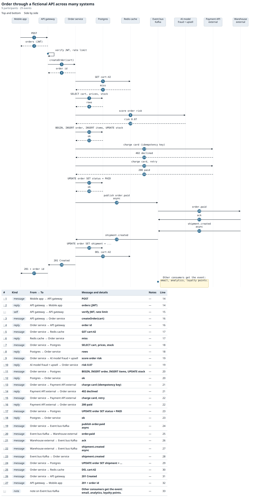
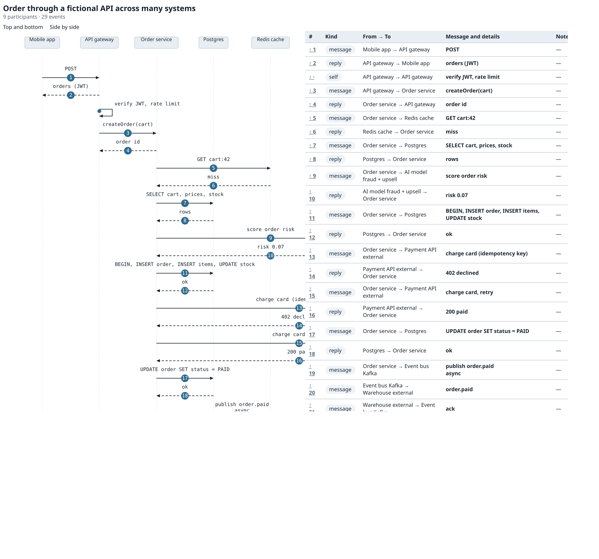
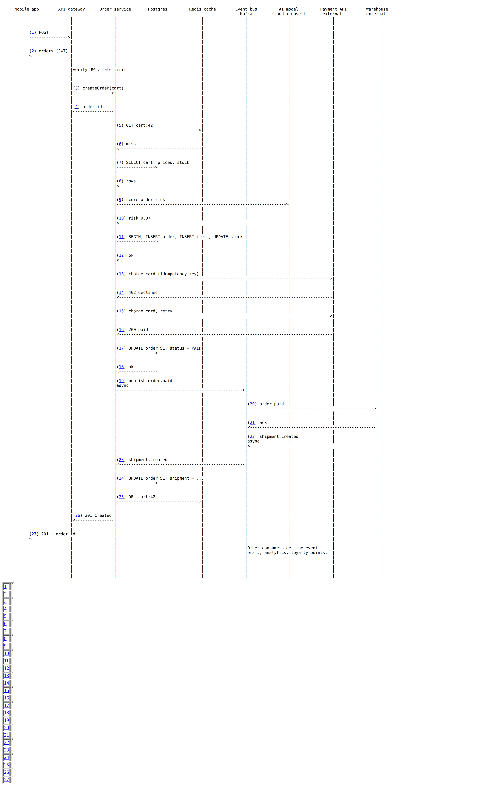
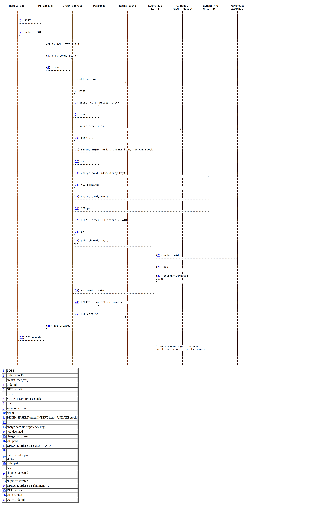
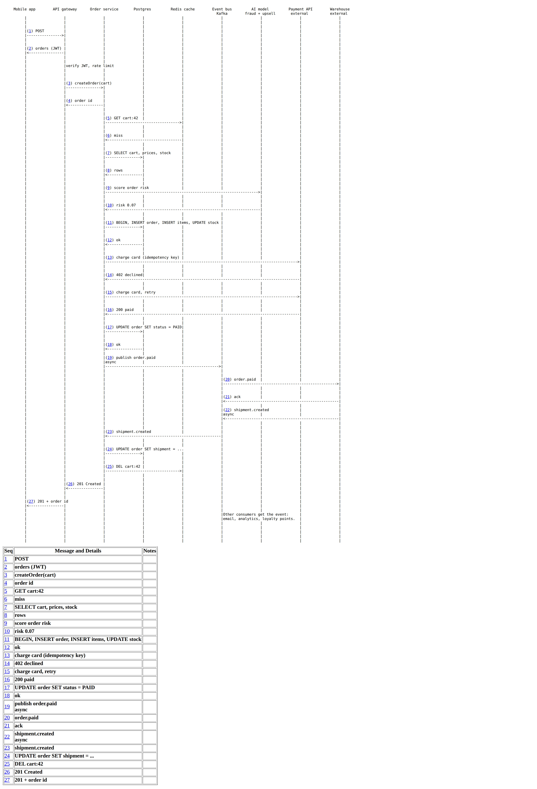
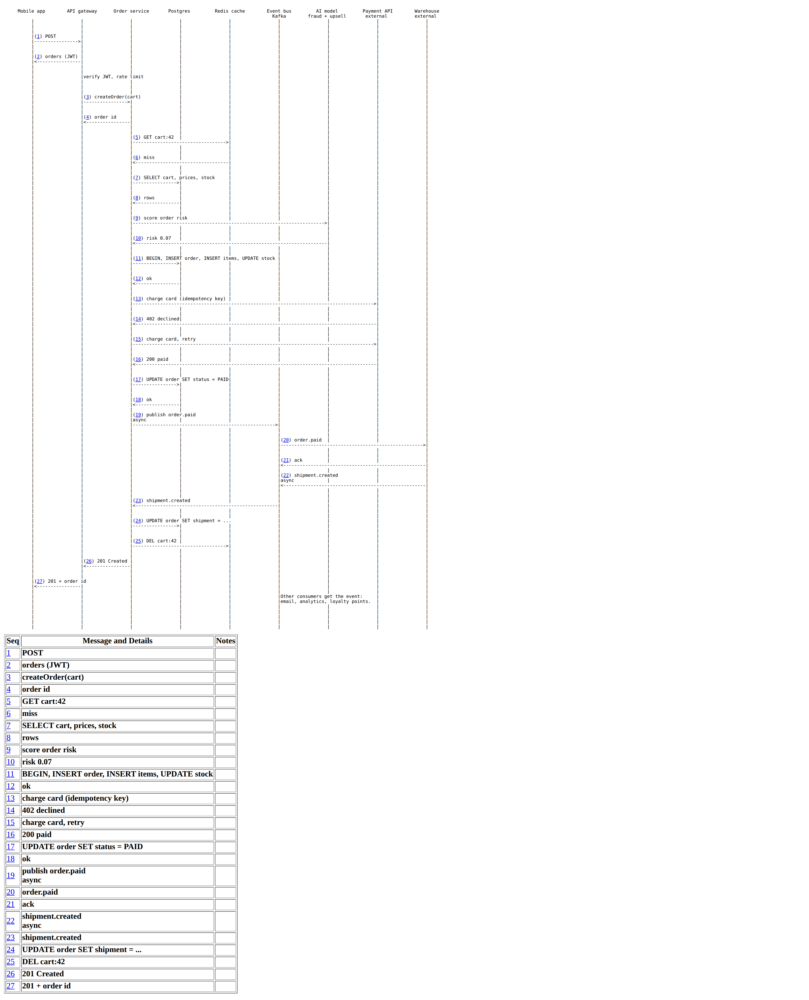
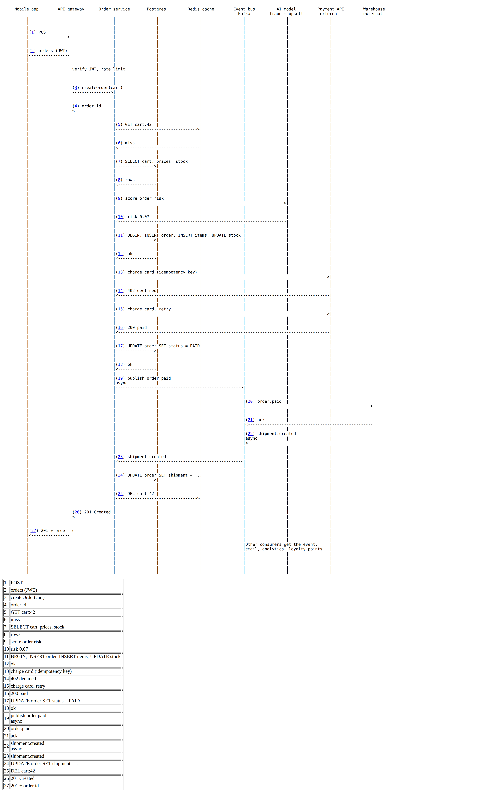
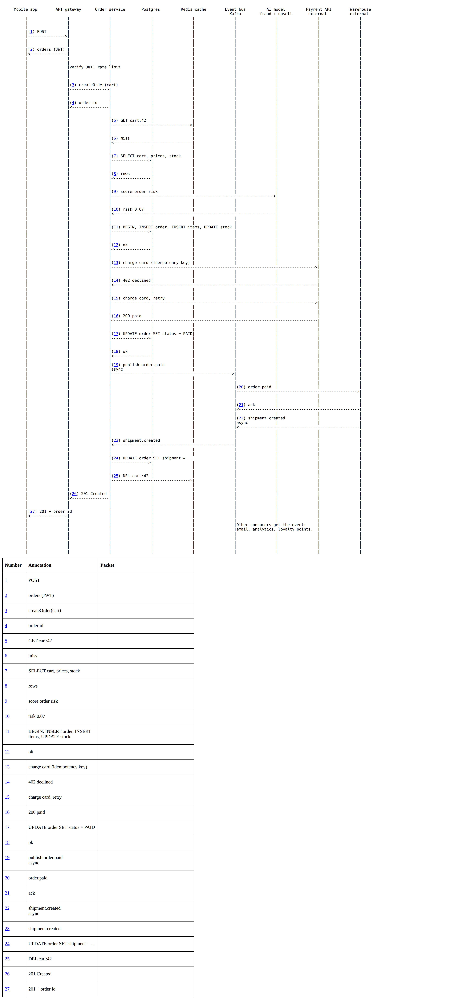

# callplot (Rust)

Turn a plain-text call flow into a sequence diagram: ASCII art, SVG, Mermaid,
PlantUML, a linked HTML page, and more.

This is a Rust port of **callplot**, the Java tool by Dave Ladd at dynamicsoft.
Its classic outputs are byte-for-byte the same as the original — and, being a
sibling port, the same as the callplot-js and callplot-python ports too. The
port is zero-runtime-dependency and `unsafe`-free.

## Install

Built from source; needs Rust 1.85 or newer (validated on rustc 1.97).

```sh
cargo build                    # commands land in target/debug/
cargo install --path .         # installs the 3 commands: callplot, plottable, callplot-prep
callplot --help
```

## Quick start

Write a file named `fred`:

```
opt/columnPitch/15
guy/f/Fred
guy/b/Barney
f->b/Please
note/b/Gives bowling ball
b->f/Stuff
b..f/RTP
f->b/Thank You
b->f/You're Welcome
```

Run `callplot fred`:

```
        Fred          Barney
          |              |
          |              |
          |              |
          |Please        |
          |------------->|
          |              |
          |              |
          |              |Gives bowling ball
          |              |
          |              |
          |              |
          |Stuff         |
          |<-------------|
          |              |
          |              |
          |RTP           |
          |..............|
          |              |
          |              |
          |Thank You     |
          |------------->|
          |              |
          |              |
          |You're Welcome|
          |<-------------|
          |              |
          |              |
          |              |
          |              |
```

Run `callplot -html fred > fred.html` and open it in a browser for the drawn
version with a linked detail table.

## Sample output

`callplot -html` makes one page: the drawn diagram with numbered badges, and a
detail table whose rows link back to the diagram. The layout is a radio button
inside the page; side by side needs a window 1100 px or wider. Captured from
`docs/diagrams/api.msd`, the widest example diagram (9 systems, 27 events):




`callplot -table=style` pairs the ASCII diagram with a linked table. All six
styles, the same input (`docs/diagrams/api.msd`):








The port's HTML and table bytes are byte-identical to the JS/Java oracles, so
the JS port's screenshots (`callplot-js/docs/images`, regenerated headless by
its `npm run shots`) apply to this port's output as-is.

## Input language

One command per line.

| Line | Meaning |
|---|---|
| `guy/a/Alice^UA` | Add a participant. `a` is its short name. `^` starts a new label line. |
| `a->b/INVITE` | Arrow from `a` to `b`. |
| `a->b/INVITE/200 OK` | Request and reply. Each extra field flips the direction. |
| `a..b/RTP` | Dotted line, no arrowhead (for example a media stream). |
| `a--b/RTP` | Dotted line. OmniGraffle repeats the label in each column. |
| `note/a/Phone rings` | A note on `a`'s lifeline. |
| `opt/name/value` | Set an option (see below). |
| `!text` | A comment on the last message. Shown in the "Notes" column of tables. |
| `!!text` | A detail on the last message. Shown with the message in tables. |
| `-a->b/X` | A leading `-` hides the next message. |
| `# text` | A comment line. Ignored. |
| `\/` | A literal `/` in a caption. |

Lines that start with a space are not read as `guy`, `note`, or `opt` lines.
This is how the original tool works.

## Outputs

| Flag | Output |
|---|---|
| (none) | ASCII art |
| `-pic` | pic(1) |
| `-xml` | ASCII art plus annotations, as XML |
| `-vml`, `-vxml` | Vector Markup Language (old Internet Explorer and Office) |
| `-svg` | SVG |
| `-graffle` | OmniGraffle 5 |
| `-table[=style]` | HTML or Word table with links to the diagram. Styles: `archtable` (default), `htmltable`, `htmltable2`, `htmltable3`, `nolinks`, `wordtable`. |
| `-mermaid` | Mermaid `sequenceDiagram` (new) |
| `-plantuml` | PlantUML sequence diagram (new) |
| `-html[=layout]` | A modern HTML page: drawn diagram plus linked detail table. Layout `topbottom` (default) or `sidebyside`. (new) |

A flag applies to every file after it: `callplot a.txt -svg b.txt c.txt`.
Use `-` to read standard input.

## Options

| Option | Default | Effect |
|---|---|---|
| `messageNumbering` | off | Number the messages: `(1) INVITE`. |
| `noteNumbering` | off | Also number notes and self-messages. |
| `columnPitch` | 10 | Characters between lifelines. |
| `linePitch` | 4 | Lines between messages. |
| `crunch` | off | Remove empty lines. |
| `stagger` | off | Offset every second label box (SVG, VML, Graffle). |
| `topLabel` / `bottomLabel` | on / off | Show labels at the top / bottom. |
| `title` | — | Title for Mermaid, PlantUML, and HTML. |
| `htmlLayout` | `topbottom` | `topbottom` or `sidebyside` for `-html`. |

Booleans accept `on/off`, `yes/no`, `true/false`. The full option list (pitch,
`startLine`/`startColumn`, and the VML style overrides) is in the tool's own
`callplot --help` and in `DESIGN-RUST.md` §3.

## Annotated tables

```sh
callplot -table=htmltable3 flow.txt > flow.html
plottable -style htmltable3 flow.txt > flow.html     # same, old command form
```

Turn on `opt/messageNumbering/on`. Only numbered messages get a table row.
In table output, write `&lt;`, `&gt;`, and `&amp;` for `<`, `>`, and `&` in
annotations. A raw `<` or `&` is an error, as in the original tool. `plottable`
keeps intermediate files with `-debug`.

## Import a packet trace

```sh
callplot-prep trace.txt > flow.txt
callplot -html flow.txt > flow.html
```

`callplot-prep` reads a text trace with `Date`, `Source Address`, and
`Destination Address` lines and SIP or HTTP start lines. Add `--links` to turn
on diagram links.

## Use it as a library

```rust
use callplot::api::{render, render_opts, render_html};
use callplot::constants::{MODE_SVG, MODE_TABLE, MODE_HTML};

let svg   = render(text, MODE_SVG);                        // Result<Vec<u16>, Ex>
let table = render_opts(text, MODE_TABLE, "htmltable3");
let page  = render_html(text, MODE_HTML, "sidebyside");
```

`render` is pure: no I/O, no panics across the boundary — bad input returns an
error value `Ex { kind, msg }` rather than throwing. Text is UTF-16 code units
(the Java `char` model); `callplot.cli.decode_java_utf8` decodes raw bytes the
Java 8 way, replacement-character quirks included.

## Compatibility

The classic outputs (ASCII, pic, XML, VML, SVG, OmniGraffle, the 6 table
styles, and `callplot-prep`) match the original Java tool byte for byte,
including its known quirks. For example, these outputs do not escape `&` or
quotes. Do not put untrusted text in them. The new outputs (Mermaid, PlantUML,
HTML) escape all text. The known differences are listed in `DESIGN-RUST.md`
Appendix B — for this port one erratum applies: `callplot-prep --debug-file`
overwrites its target instead of appending.

Validated green against the shared read-only oracles: 702/702 goldens, 216/216
snapshots (mermaid/plantuml/html × both layouts), 8/8 prep cases, 85/85
reference outputs, 16/16 CLI cases, and the 28 trap tests from `DESIGN-RUST.md`
§4.4.

## Skill: design-to-msd

The callplot-js port ships an OpenCode skill, `design-to-msd`, that turns a
design document (a spec, a protocol write-up, a plan) into a callplot `.msd`
input plus a rendered diagram. Copy its directory from
`callplot-js/.opencode/skills/design-to-msd/` into this repo's
`.opencode/skills/` to use it here; OpenCode advertises it automatically when
relevant, and you can force it by mentioning `@design-to-msd` in your prompt:

    Turn DESIGN.md into a call-flow diagram with @design-to-msd

The skill writes `docs/diagrams/<slug>.msd` using its bundled msd grammar,
validates it, and renders the default top-bottom HTML page with this port:

```sh
callplot -html docs/diagrams/<slug>.msd > docs/diagrams/<slug>.html-topbottom.html
```

Claude Code reads skills from `.claude/skills/` instead: copy the directory to
`.claude/skills/design-to-msd/` and run `/design-to-msd` at the prompt; its
description makes it auto-invoke the same way.

The plan for the next DESIGN.md revision is to feed that document to the
skill: every future design gets its call-flow diagram and tables this way.

## Development

```sh
cargo build                  # 3 commands plus the dev codegen drivers (gencases, gensnap, genprep, genref)
cargo test --test traps      # the 28 DESIGN-RUST.md §4.4 trap tests
```

The golden, snapshot, reference, prep, and CLI suites run the built binaries
against the read-only `callplot-python/test` and `callplot-python/samples`
trees in the parent workspace; the drivers and their current results are
described honestly in `NOTES-STATE.md`. The golden files come from the original
tools: Java 8, Xalan, and awk — regenerating them needs Java 8. Differential
fuzzing against the Java oracle (DESIGN-RUST.md §4.6) is planned.

Examples of every output for every sample are in `samples/reference/` of the
sibling ports (5 samples × 17 outputs, all 85 byte-verified against this port).

## License

LGPL-2.1-only, the same as the original callplot. Original code © dynamicsoft.
