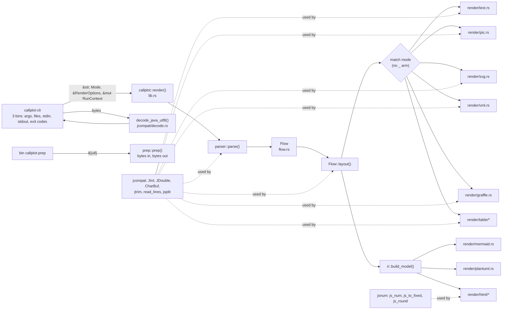
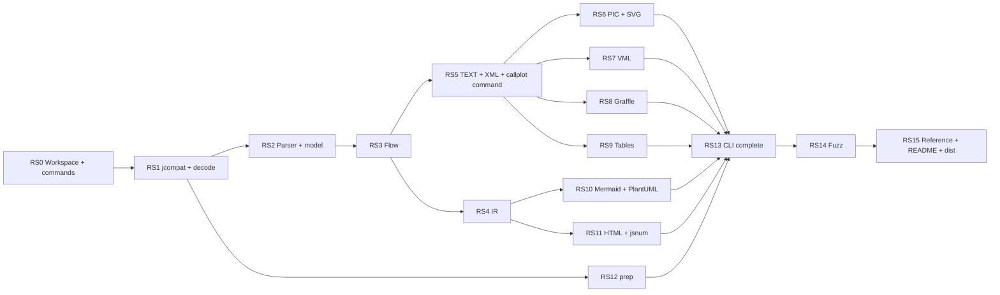

# callplot-rs — Rust Design and Work Plan

Status: Ready for implementation · Author: Edgar Villanueva (with Claude) · Version: 2 · Date: 2026-11-15 · Runtime: Rust 1.85 or newer (edition 2024) · Companion to: DESIGN.md Version 12 and DESIGN-PYTHON.md Version 2 · Reference runtime: OpenJDK 1.8.0_504

This document is a **companion** to `DESIGN.md`. It tells the builder how to make the Rust port. The builder is a coding agent or a junior developer.

**Which document wins**

1. **Behavior** (what each output contains, byte for byte): `DESIGN.md` and the Java oracle win. This document never changes an output.
2. **Language, tools, files, and commands**: this document wins. `DESIGN.md` describes Node.js. `DESIGN-PYTHON.md` describes Python. Do not copy their tools.
3. If you find a conflict, stop. Ask Edgar. Write the conflict in Appendix B.

**How to read this document**

1. Read section 1 (Overview) and section 2 (High Level Design). They take about 20 minutes.
2. Do the checklist in section 1.5.
3. Go to section 5 (Work Plan). Do the chunks in order. Each chunk names the parts of `DESIGN.md` and of this document to read.
4. Read sections 3 and 4 one part at a time, when a chunk asks for it.

**Verified claims.** Items tagged ✅ were run on 2026-11-15 with rustc 1.99.1 (Homebrew), OpenJDK 1.8.0_504, macOS `/usr/bin/awk`, and Node 24 on macOS. They cover the workspace skeleton, the clippy bans, the closed-pipe exit, and every row of the trap table in section 3.4. The spike code is not in the repository. The tests in section 4.4 repeat each check.

**What changed in Version 2 (2026-11-15).** `DESIGN.md` Version 12 adds the shared fixture `utf8_surrogate_bytes` and the 18-row decode table (section 3.5 there). Now there are 58 fixtures and 710 goldens. The `js_round` rule is fixed: `floor(x + 0.5)` is not exact (section 3.7). Appendix A items 5 and 7 are closed.

---

## 1. Overview

### 1.1 Goal

Port callplot to Rust. The Rust port must give the **same bytes** as the Java oracle, in the same 17 outputs as the JS port. It must look and work like a normal Rust tool. A user installs it with `cargo install`. The user then types `callplot`, `plottable`, and `callplot-prep`.

| Group | Outputs | Oracle |
|---|---|---|
| Compatible | 7 core modes, 6 table styles, `callplot-prep` | Java 8, Xalan, awk. The goldens already exist from the JS port. |
| New | Mermaid, PlantUML, HTML top and bottom, HTML side by side | The snapshots that Edgar approved for the JS port |

### 1.2 Lesson from the Python port: do not port too literally

The first Python port copied the JS **file layout**. It made a `bin/` folder with scripts that a user runs by path (`python3 bin/callplot.py`). `DESIGN-PYTHON.md` section 1.2 has the full story. Do not repeat it in Rust. A Rust user never types `cargo run --bin callplot -- -svg fred`. The user types `callplot -svg fred`.

Each row is a JS or Python habit and its Rust way.

| JS or Python habit (do not copy) | Rust way |
|---|---|
| `bin/*.js` or `bin/*.py` scripts | `[[bin]]` targets in `callplot-cli/Cargo.toml`. Users run `cargo install`. Section 3.1. |
| `cargo run --bin X --` in user docs | Only in developer notes. The README shows the installed command. |
| `throw` and `try`/`catch` | `Result<T, CallplotError>` and the `?` operator. Section 3.5. |
| Panics as errors | A panic is a **programmer error**. Every Java exception is a `CallplotError` value. Section 3.5. |
| One number type, plus `fmtI` and `fmtD` | Two newtypes, `JInt` and `JDouble`. Their `Display` prints Java text. Section 3.3. |
| `MODES.SVG` bit numbers, `IntFlag` | `enum Mode` with one variant for each output. A `java_bits()` method gives the Java bits when a renderer needs them. |
| Option objects, frozen `dataclass` | `struct RenderOptions` with `Default`, and `enum` types with `FromStr`. |
| Classes with getters and setters | Plain `struct`s with `pub(crate)` fields. |
| `switch` with a `default`, `match` with `case _:` | An exhaustive `match` with **no** `_` arm. The compiler then proves that every mode has a renderer. |
| `Out` class, `io.StringIO` | A `String` and `std::fmt::Write` (`write!`, `writeln!`). |
| Module-level counters | A `RunContext` passed as `&mut`. No `static` state. |
| `camelCase`, `snake_case` mixed | Rust API naming: `snake_case` functions and fields, `PascalCase` types and variants, `SCREAMING_SNAKE_CASE` constants. Names that appear **in input or output** (`messageNumbering`, `NumberFormatError`) stay exactly as `DESIGN.md` writes them. |
| JSDoc, docstrings | `///` doc comments. Each renderer names its Java source file and line range. |
| ESLint, `ruff` | `clippy` with `-D warnings`. `rustfmt`. |
| `node:test`, `pytest` | `cargo test`. Golden files use `libtest-mimic` so each golden is one named test. |
| `npm pack` check, wheel check | `cargo package --list` and `cargo xtask dist-check`. |
| Long fixed text in string literals | Plain text files loaded with `include_str!` (CSS, usage text). Raw strings `r#"..."#` for Graffle fixed text. |

### 1.3 Key decisions

| # | Decision | Reason |
|---|---|---|
| **RD1** | Rust edition 2024. `rust-version = "1.85"` (the first release with edition 2024). Dev toolchain pinned in `rust-toolchain.toml`. **Zero runtime dependencies.** | Edition 2024 is the current edition. Zero dependencies keeps the supply chain empty and the build fast. |
| **RD2** | A Cargo **workspace** in `rust/` with 3 packages: `callplot` (library, the pure core), `callplot-cli` (the 3 binaries), and `xtask` (developer tools, never published). | The crate boundary keeps I/O out of the core. `xtask` is the standard Rust pattern for project scripts. ✅ The skeleton in section 3.1 builds. |
| **RD3** | The 3 commands are `[[bin]]` targets of `callplot-cli`. `cargo install --path rust/crates/callplot-cli` installs all 3. | This is how Rust tools ship. ✅ The install put `callplot`, `plottable`, and `callplot-prep` in `bin/`. |
| **RD4** | **One repository, three ports.** The Rust port lives in `rust/`. Shared data stays at the repo root: `test/`, `samples/`, `reference/`, `tools/`. Rust only **reads** it. | One set of goldens. No copies drift apart. Same rule as `DESIGN-PYTHON.md` PD4. |
| **RD5** | Behavior comes from `DESIGN.md`. Java is the oracle. | Same rule as the JS and Python ports. |
| **RD6** | Text is held as Rust `String` (UTF-8). Every **length or index** that Java computes counts **UTF-16 code units**. `CharBuf` holds `u16`. Section 3.2. | A Java `char` is one UTF-16 unit. Rust `str` counts bytes, and `chars()` counts code points. This keeps the code idiomatic and still matches Java. |
| **RD7** | Java numbers are the newtypes `JInt(i32)` and `JDouble(f64)`. Their operators copy Java rules (wrap on overflow, truncate on divide). Their `Display` prints Java text. `as` casts are banned in the core. | `DESIGN.md` D4 says number types cause most mismatches. In Rust the compiler can enforce it. |
| **RD8** | The core is **pure**: no `std::fs`, `std::io` stdio, `std::env`, `std::process`, or print macros. The crate boundary and `clippy.toml` bans enforce it. `#![forbid(unsafe_code)]` in every crate. | Same idea as the JS "pure core" rule. ✅ The bans flagged `println!`, `str::trim`, `str::lines`, and `str::split_whitespace` in the spike. |
| **RD9** | The core never panics on any input. `indexing_slicing`, `unwrap_used`, `expect_used`, and `panic` are clippy **errors** in the core. | A panic is a programmer error. Java exceptions are values (`CallplotError`). |
| **RD10** | The 4 new outputs must equal the **JS-approved snapshots**, byte for byte. Rust makes **no** snapshots of its own. | Edgar already approved them. Same rule as `DESIGN-PYTHON.md` PD8. |
| **RD11** | Dev dependencies: `libtest-mimic` and `similar`. Dev tools: `clippy`, `rustfmt`, `cargo-llvm-cov`, `cargo-deny`. Ask before you add another. | |
| **RD12** | The builder **never writes Java**. All Java files are provided (`DESIGN.md` sections 4.5.1 and 4.5.2). | An earlier agent went into a text loop while it wrote Java. |
| **RD13** | Input bytes are decoded with `decode_java_utf8`, not `String::from_utf8_lossy`. Section 3.2. | ✅ Java 8 and Rust replace some bad UTF-8 sequences differently. |

### 1.4 What carries over from DESIGN.md

| `DESIGN.md` section | Use in the Rust port |
|---|---|
| 1.3 Reference sources, 1.4 Output matrix, 1.5 Glossary | Unchanged. |
| 2.7 Diagrams of the tool | Unchanged. The flow inside one run is the same in Rust. |
| 3.1–3.4 Parser, model, options, layout, renderers | **The behavior to build.** Follow the algorithms step by step. |
| 3.5 Java-compatibility layer | The helper list stays. This document gives the Rust version (section 3.3). |
| 3.6 `RunContext` | Same 3 counters. Section 3.5 here. |
| 3.7 CLI | Same flags and exit codes. Section 3.6 here. |
| 3.8 Quirks | Unchanged. Do **not** fix any of them. |
| 3.9–3.14 New outputs, tables, prep | The behavior to build. Section 3.7 adds the JS number rules for the new outputs. |
| 4.2–4.4 Oracle, fixtures, CLI cases | **Reused as they are.** Do not regenerate them. |
| 4.5.1–4.5.3 Fast oracle, probes, traps | **Reused as they are.** The Java files are provided. |
| 4.7 Snapshots, 4.10 Reference samples | **Reused.** Rust compares to them. |
| 2.5 Node best practices, 2.6 CI, 4.8 Browser tests, 4.9 Quality gates | **Replaced.** Sections 2.5, 2.6, and 4.7 here. |
| 5 Work Plan, 6 Estimate | **Replaced.** Sections 5 and 6 here. |

### 1.5 Before you start (checklist)

1. Open `DESIGN.md`. Line 3 must say `Version: 12` or a higher number. If it does not, ask Edgar.
2. Read this document once from top to bottom.
3. Run `rustc --version` and `cargo --version`. Both must be 1.85 or newer. Record the output.
4. Run `rustup component list --installed` if you use `rustup`. `clippy` and `rustfmt` must be there. With Homebrew Rust, run `cargo clippy --version` and `cargo fmt --version`.
5. Run `java -version 2>&1`. It must show `1.8.0`. Java is used only by the shared tools and the fuzz client.
6. Check that the shared data exists:
   - `find test/golden -maxdepth 1 -name '*.out' | wc -l` prints `710`.
   - `reference/build/com/dynamicsoft/callplot/Main.class` exists.
   - `reference/build-tools/FuzzOracle.class` and `reference/build-probes/ExitProbe.class` exist.
7. Chunks RS10 and RS11 need the approved snapshots in `test/snapshots/`. If they are not there, do the other chunks first. Tell Edgar.
8. Chunk RS11 needs the JS source of `src/render/html/*.js`. If it is not in the repository, tell Edgar before RS11.
9. If any item fails, stop. Ask Edgar. Do not rebuild the shared data yourself.
10. Create the work folder: `mkdir -p rust/docs`. Progress notes go in `rust/docs/progress.md`.

---

## 2. High Level Design

### 2.1 The commands

A user installs the tool once. Then the 3 commands exist in the shell.

```
cargo install --path rust/crates/callplot-cli     # later: cargo install callplot-cli
callplot --help
callplot -svg fred > fred.svg
plottable -style htmltable3 flow.txt > flow.html
callplot-prep --links trace.txt > flow.txt
```

`cargo install` puts the 3 binaries in `~/.cargo/bin`. ✅

A developer works in the workspace:

```
cd rust
cargo build                       # debug build of all 3 commands
cargo test                        # unit, golden, snapshot, reference, and CLI tests
cargo clippy --all-targets -- -D warnings
cargo fmt --check
cargo xtask fuzz --seed 1 --count 2000
```

Each binary has `fn main() -> std::process::ExitCode`. It returns the exit code. It never calls `std::process::exit`, because that skips flushing and destructors.

### 2.2 Architecture



Data moves in one direction: text → `Flow` → renderer → `String`. The flow is the same as `DESIGN.md` section 2.1. The differences are only in types: errors are `Result` values, and numbers are `JInt` and `JDouble`.

### 2.3 Module map

The core is in `rust/crates/callplot/src/`.

| Rust module | JS module | Responsibility |
|---|---|---|
| `lib.rs` | `index.js` | `render()`, `prep()`, and the public re-exports. `#![forbid(unsafe_code)]`. |
| `constants.rs` | `constants.js` | The fixed numbers (`GRAFFLE_MULT` and the others) as `JInt` constants. The Java mode bits. |
| `mode.rs` | `MODES` | `enum Mode` and `java_bits()`. |
| `error.rs` | error classes in `jcompat.js` | `enum CallplotError`, `name()`, `Display`, `std::error::Error`. Section 3.5. |
| `jcompat/num.rs` | `fmtI`, `fmtD`, `idiv` | `JInt`, `JDouble`. Section 3.3. |
| `jcompat/text.rs` | `javaTrim`, `javaSplit`, `tokenize` | `jtrim`, `read_lines`, `jsplit_unescaped_slash`, `tokenize_caret`, `jlen`, `parse_java_int`. |
| `jcompat/charbuf.rs` | `CharBuf` | `CharBuf` over `Vec<u16>`, and `to_java_output()`. |
| `jcompat/decode.rs` | (none) | `decode_java_utf8(&[u8]) -> String`. Section 3.2. |
| `jsnum.rs` | (JS built-ins) | `js_num`, `js_to_fixed`, `js_round`. Only the new outputs use them. Section 3.7. |
| `context.rs` | `context.js` | `RunContext`. |
| `model.rs` | `model.js` | `Player`, `Message`, caption digest. |
| `parser.rs` | `parser.js` | `parse(text) -> Result<Flow, CallplotError>`. DESIGN 3.1. |
| `options.rs` | (JS options bag) | `RenderOptions`, `TableStyle`, `HtmlLayout`, and their `FromStr`. The input options of DESIGN 3.3 (`FlowOptions`). |
| `flow.rs` | `flow.js` | `Flow`, `layout()`, `column_of`, `label_line`, numbering. DESIGN 3.3 and 3.4.0. |
| `ir.rs` | `ir.js` | `build_model(&Flow) -> Model`. DESIGN 3.9. |
| `escape.rs` | `escape.js` | `esc_html`, `esc_mermaid`, `esc_plantuml`. |
| `render/text.rs`, `pic.rs`, `svg.rs`, `vml.rs`, `graffle.rs` | `render/*.js` | One renderer for each core mode. `text.rs` also has `draw_text_lines` for the tables. |
| `render/mermaid.rs`, `plantuml.rs` | same | New outputs. |
| `render/table/mod.rs` and `archtable.rs`, `htmltable.rs`, `htmltable2.rs`, `htmltable3.rs`, `nolinks.rs`, `wordtable.rs` | `render/table/*.js` | The shared row list, and one module for each style. |
| `render/html/layout.rs`, `svg.rs`, `page.rs`, `style.rs`, `style.css` | `render/html/*.js` | The new `-html` output. `style.rs` has `pub const CSS: &str = include_str!("style.css");`. |
| `prep/mod.rs`, `prep/awk.rs` | `prep/prep.js` | `prep(&[u8], PrepOptions) -> Vec<u8>`, `awk_fields`, `awk_num`. |

The commands are in `rust/crates/callplot-cli/src/`.

| File | JS file | Responsibility |
|---|---|---|
| `lib.rs` | (shared CLI code) | `run_callplot`, `run_plottable`, `run_prep`. Each takes `args`, `stdin`, `stdout`, and `stderr` as parameters and returns a `u8` exit code. Tests can call them in process. |
| `bin/callplot.rs` | `bin/callplot.js` | 5 lines. Calls `run_callplot` with the real streams. |
| `bin/plottable.rs` | `bin/plottable.js` | 5 lines. Calls `run_plottable`. |
| `bin/callplot-prep.rs` | `bin/callplot-prep.js` | 5 lines. Calls `run_prep`. |
| `usage.txt` | `USAGE` constant | The usage text, with its tabs, loaded with `include_str!`. |

There is no module named after a JS file that would hide a function. In Rust, a module (`render`) and a function (`render()`) live in different name spaces, so there is no clash.

### 2.4 Public API

```rust
use callplot::{render, prep, Mode, RunContext, RenderOptions, TableStyle, HtmlLayout, PrepOptions};

let mut ctx = RunContext::default();                       // the CLI shares one ctx across files
let svg = render(&source, Mode::Svg, &mut ctx, &RenderOptions::default())?;

let table = render(&source, Mode::Table, &mut ctx,
                   &RenderOptions { table_style: TableStyle::Htmltable3, ..Default::default() })?;
let page = render(&source, Mode::Html, &mut ctx,
                  &RenderOptions { html_layout: Some(HtmlLayout::SideBySide),
                                   id_prefix: "flow1-".into(), ..Default::default() })?;
let msd: Vec<u8> = prep(&trace_bytes, PrepOptions { links: true });
let text = callplot::decode_java_utf8(&file_bytes);         // use this, not from_utf8_lossy
```

- `pub fn render(text: &str, mode: Mode, ctx: &mut RunContext, options: &RenderOptions) -> Result<String, CallplotError>`.
  - It builds the whole output in memory and returns it.
  - On a bad input it returns `Err`. It returns no partial output.
  - It never prints, never reads a file, and never panics.
- `RenderOptions` has 3 fields: `table_style: TableStyle` (default `Archtable`), `html_layout: Option<HtmlLayout>` (default `None`), and `id_prefix: String` (default empty). When `html_layout` is `Some`, it overrides `opt/htmlLayout` in the input. It derives `Debug`, `Clone`, `Default`, `PartialEq`, `Eq`.
- `TableStyle` has 6 variants: `Archtable`, `Htmltable`, `Htmltable2`, `Htmltable3`, `Nolinks`, `Wordtable`. `TableStyle::from_str` accepts the 6 lower-case names and `tmltable` (same as `htmltable`). An unknown name returns `Err(CallplotError::UnknownTableStyle(name))`.
- `HtmlLayout` has `TopBottom` and `SideBySide`. `from_str` accepts `topbottom` and `sidebyside`.
- `Mode` has 11 variants: `Text`, `Pic`, `Xml`, `Vml`, `Vxml`, `Svg`, `Graffle`, `Mermaid`, `PlantUml`, `Html`, `Table`. `Mode::java_bits()` returns the Java bit value (`Vxml` gives `VML | XML`). Use it only where Java tests a bit.
- `pub fn prep(input: &[u8], options: PrepOptions) -> Vec<u8>`. Bytes in, bytes out, like awk. It cannot fail.
- `RunContext`, `CallplotError`, `Mode`, `TableStyle`, and `HtmlLayout` are `Send` and `Sync`. The core has no global state, so 2 threads can render at the same time with 2 contexts.
- Mark `Mode`, `TableStyle`, `HtmlLayout`, and `CallplotError` `#[non_exhaustive]`. New variants then do not break library users.
- `callplot` exports nothing else. Internal items are `pub(crate)`.

### 2.5 Repository layout

```
callplot-js/                         the existing repository
├── rust/
│   ├── Cargo.toml                   workspace (section 3.1)
│   ├── Cargo.lock                   committed (the workspace has binaries)
│   ├── rust-toolchain.toml          channel = "1.99.1", components = ["clippy", "rustfmt"]
│   ├── rustfmt.toml, deny.toml, .cargo/config.toml (the xtask alias)
│   ├── README.md, LICENSE (copy)
│   ├── crates/
│   │   ├── callplot/                the pure core (library)
│   │   │   ├── Cargo.toml, clippy.toml
│   │   │   ├── src/                 section 2.3
│   │   │   └── tests/               golden.rs, snapshots.rs, reference.rs, common/mod.rs
│   │   └── callplot-cli/            the 3 commands
│   │       ├── Cargo.toml
│   │       ├── src/                 lib.rs, usage.txt, bin/*.rs
│   │       └── tests/               cli.rs
│   ├── xtask/                       fuzz, oracle client, dist-check (never published)
│   └── docs/progress.md
├── test/ samples/ reference/ tools/ DESIGN.md DESIGN-PYTHON.md DESIGN-RUST.md     SHARED. Rust reads only.
```

- The shared folders are owned by the JS port. Do not edit, move, or regenerate anything in them.
- The one exception: Rust fuzz may **add** fixtures named `rsseedS_caseK` to `test/fixtures/fuzz/` (section 4.6).
- Tests find the repo root from `env!("CARGO_MANIFEST_DIR")`. The core crate's manifest is 3 folders below the root. Put this in one place: `tests/common/mod.rs`.
- The build output (`rust/target/`) goes in `.gitignore`.

### 2.6 Rust best practices

These rules replace section 2.5 of `DESIGN.md`. The sources are the Rust API Guidelines, the Cargo Book, the Clippy lint list, and the Rust Edition Guide.

| Area | Practice | What to do in this project |
|---|---|---|
| Structure | Workspace, one job for each crate | Core library, CLI crate, `xtask`. One renderer in each module. |
| Naming | Rust API Guidelines (C-CASE) | `snake_case`, `PascalCase`, `SCREAMING_SNAKE_CASE`. Conversions are `to_*`, `as_*`, `into_*`. Names that appear in input or output keep the `DESIGN.md` spelling. |
| Errors | One error `enum`, no panics | `CallplotError` implements `Display` and `std::error::Error`. No `thiserror` or `anyhow` (zero dependencies). |
| Error, one place | One handler for each command | `run_*` in `callplot-cli/src/lib.rs` turns each `Err` into stderr text and exit code `1`. |
| Panics | Never in the core | Clippy denies `unwrap_used`, `expect_used`, `panic`, `indexing_slicing`, `unreachable` in the core. Use `.get(i)` and return `CallplotError::Index`. |
| Numbers | Newtypes | `JInt` and `JDouble`. Clippy denies `as_conversions` in the core. `overflow-checks = true` in every profile, so a raw `i32` overflow panics in tests and is found. |
| Unsafe | None | `#![forbid(unsafe_code)]` in every crate root. |
| Lint | `clippy` | `clippy::all` is an error. `clippy::pedantic` is a warning, and CI runs with `-D warnings`. Allow a pedantic lint only with a one-line reason next to the `#[allow]`. |
| Format | `rustfmt` | `cargo fmt --check` passes. `max_width = 100`. |
| Strings | Build once | `String::with_capacity` and `write!`. No `format!` inside `push_str` (`clippy::format_push_string`). |
| Fixed text | Data files and raw strings | CSS and usage text through `include_str!`. Graffle and VML text as raw strings `r#"..."#`. |
| Dispatch | Exhaustive `match` | `render()` matches every `Mode` variant. No `_` arm inside the crate. No trait objects or registries for renderers. |
| Collections | Deterministic | `BTreeMap` or `Vec` where order can reach the output. `HashMap` is banned in the core by `clippy.toml`. |
| Regex | None at run time | The parser and prep need only fixed patterns. Write small scanners by hand. This keeps zero dependencies and linear time. A unit test runs the parser on one 100,000-character line in under 1 second. |
| Child processes | Only in `xtask` and tests | `std::process::Command` with an argument list. Never build a shell string. |
| Testing | `cargo test` | Unit tests in `#[cfg(test)] mod tests` next to the code. Integration tests in `tests/`. Test names: `<unit>__<scenario>__<expected>` (allow `non_snake_case` for the double underscore). |
| Coverage | `cargo-llvm-cov` | `cargo llvm-cov --workspace --fail-under-lines 90`. |
| Supply chain | `cargo-deny` | `cargo deny check` in CI: licenses, advisories, and banned sources. `Cargo.lock` is committed. |
| Packaging | Cargo metadata | `license = "LGPL-2.1-only"`, `description`, `repository`, `rust-version`, `include` lists (section 3.1). |
| Docs | `///` and `//!` | Each renderer function has a doc comment that names its Java source file and line range. `cargo doc --no-deps` gives 0 warnings. |
| MSRV | Tested | CI builds with 1.85 and with the pinned toolchain. |

Not applied: async code, `tokio`, logging crates, `clap`, and any web-server practice. A CLI with these flag rules needs a hand-written argument loop (section 3.6).

### 2.7 Continuous integration

One workflow file, `.github/workflows/rust.yml`.

| Job | Steps | Needs Java? |
|---|---|:-:|
| `check` | Pinned toolchain. `cargo fmt --check` → `cargo clippy --workspace --all-targets -- -D warnings` → `cargo test --workspace` → `cargo doc --no-deps` | No (goldens are committed) |
| `msrv` | Toolchain 1.85. `cargo build --workspace` → `cargo test --workspace` | No |
| `coverage` | `cargo llvm-cov --workspace --fail-under-lines 90` | No |
| `deny` | `cargo deny check` | No |
| `dist` | `cargo package -p callplot --list` → `cargo package -p callplot-cli --list` → `cargo xtask dist-check` | No |
| `wasm` (optional) | `rustup target add wasm32-unknown-unknown` → `cargo build -p callplot --target wasm32-unknown-unknown` | No |
| `fuzz` | Manual or nightly. `cargo xtask fuzz --seed 1 --count 2000` | Yes |

The `wasm` job proves that the core builds with no operating system. It is the Rust version of the JS rule "the core also runs in a browser". There is no browser job and no Mermaid or PlantUML syntax job. The Rust output equals the JS snapshots byte for byte. The JS jobs already check those files.

---

## 3. Detailed Design

### 3.1 Workspace, packages, and lints

✅ A workspace with this shape was built on 2026-11-15 with stub code. `cargo build --release` made the 3 binaries. `cargo install --path crates/callplot-cli` installed all 3. The `clippy.toml` bans fired on `println!`, `str::trim`, `str::lines`, `str::split_whitespace`, and indexing. Write the files below. Keep the comments.

**`rust/Cargo.toml`**

```toml
[workspace]
resolver = "3"
members = ["crates/callplot", "crates/callplot-cli", "xtask"]

[workspace.package]
version = "0.1.0"
edition = "2024"
rust-version = "1.85"
license = "LGPL-2.1-only"
repository = "https://github.com/OWNER/callplot-js"   # Edgar sets OWNER

[workspace.dependencies]
callplot = { path = "crates/callplot", version = "0.1.0" }
libtest-mimic = "0.8"
similar = "2"

# Lints for the CLI and xtask. The core sets its own, stricter list.
[workspace.lints.rust]
unsafe_code = "forbid"

[workspace.lints.clippy]
all = { level = "deny", priority = -1 }
pedantic = { level = "warn", priority = -1 }

[profile.dev]
overflow-checks = true

[profile.release]
overflow-checks = true
lto = true
codegen-units = 1
```

**`rust/crates/callplot/Cargo.toml`**

```toml
[package]
name = "callplot"
description = "Draw call-flow (sequence) diagrams from a text file. A Rust port of callplot 0.2."
version.workspace = true
edition.workspace = true
rust-version.workspace = true
license.workspace = true
repository.workspace = true
include = ["src/**", "Cargo.toml", "README.md", "LICENSE"]

[dependencies]
# none. Ask Edgar before you add one.

[dev-dependencies]
libtest-mimic.workspace = true
similar.workspace = true

[[test]]
name = "golden"
harness = false

[[test]]
name = "snapshots"
harness = false

[[test]]
name = "reference"
harness = false

[lints.rust]
unsafe_code = "forbid"
missing_docs = "warn"

[lints.clippy]
all = { level = "deny", priority = -1 }
pedantic = { level = "warn", priority = -1 }
disallowed_methods = "deny"
disallowed_macros = "deny"
disallowed_types = "deny"
as_conversions = "deny"
indexing_slicing = "deny"
unwrap_used = "deny"
expect_used = "deny"
panic = "deny"
unreachable = "deny"
todo = "deny"
format_push_string = "deny"
```

**`rust/crates/callplot/clippy.toml`.** Clippy reads this file only for the core package. Do **not** put a `clippy.toml` at `rust/`. The CLI must be free to use stdout.

```toml
allow-unwrap-in-tests = true
allow-expect-in-tests = true
allow-indexing-slicing-in-tests = true
allow-panic-in-tests = true

disallowed-macros = [
  { path = "std::println", reason = "the core does no I/O" },
  { path = "std::print", reason = "the core does no I/O" },
  { path = "std::eprintln", reason = "the core does no I/O" },
  { path = "std::eprint", reason = "the core does no I/O" },
  { path = "std::dbg", reason = "the core does no I/O" },
]
disallowed-types = [
  { path = "std::fs::File", reason = "the core does no I/O" },
  { path = "std::process::Command", reason = "the core does no I/O" },
  { path = "std::collections::HashMap", reason = "use BTreeMap or Vec: order must not change output" },
  { path = "std::collections::HashSet", reason = "use BTreeSet" },
]
disallowed-methods = [
  { path = "std::fs::read", reason = "the core does no I/O" },
  { path = "std::fs::read_to_string", reason = "the core does no I/O" },
  { path = "std::io::stdout", reason = "the core does no I/O" },
  { path = "std::io::stdin", reason = "the core does no I/O" },
  { path = "std::io::stderr", reason = "the core does no I/O" },
  { path = "std::env::args", reason = "the core does no I/O" },
  { path = "std::env::args_os", reason = "the core does no I/O" },
  { path = "std::process::exit", reason = "the core does no I/O" },
  { path = "str::trim", reason = "removes Unicode spaces. Use jcompat::jtrim" },
  { path = "str::trim_start", reason = "Use jcompat::jtrim" },
  { path = "str::trim_end", reason = "Use jcompat::jtrim" },
  { path = "str::lines", reason = "does not split on a lone CR. Use jcompat::read_lines" },
  { path = "str::split_whitespace", reason = "splits on VT and NBSP. Use prep::awk::awk_fields" },
  { path = "str::len", reason = "counts bytes. Use jcompat::jlen (UTF-16 units)" },
  { path = "std::string::String::from_utf8_lossy", reason = "differs from Java 8. Use decode_java_utf8" },
  { path = "std::string::String::from_utf16_lossy", reason = "writes U+FFFD. Java writes '?'. Use CharBuf::to_java_output" },
  { path = "f64::round", reason = "rounds -2.5 to -3. Use jsnum::js_round" },
]
```

The `str::len` ban has a real cost: a renderer that needs a byte length (rare) must add `#[allow(clippy::disallowed_methods)]` with a reason. That is the point. Each byte length is then a visible choice.

**`rust/crates/callplot-cli/Cargo.toml`**

```toml
[package]
name = "callplot-cli"
description = "The callplot, plottable, and callplot-prep commands."
version.workspace = true
edition.workspace = true
rust-version.workspace = true
license.workspace = true
repository.workspace = true
include = ["src/**", "Cargo.toml", "README.md", "LICENSE"]

[dependencies]
callplot.workspace = true

[dev-dependencies]
similar.workspace = true

[[bin]]
name = "callplot"
path = "src/bin/callplot.rs"

[[bin]]
name = "plottable"
path = "src/bin/plottable.rs"

[[bin]]
name = "callplot-prep"
path = "src/bin/callplot-prep.rs"

[lints]
workspace = true
```

**`rust/.cargo/config.toml`**

```toml
[alias]
xtask = "run --package xtask --"
```

**`rust/xtask/Cargo.toml`** sets `publish = false`. It has no dependencies.

Rules:

1. Do not add a `#!` script, a `Makefile`, or a shell wrapper for the commands. `cargo install` makes the commands.
2. `cargo install --path rust/crates/callplot-cli` must put `callplot`, `plottable`, and `callplot-prep` in `~/.cargo/bin` (or `--root DIR/bin`).
3. The crate name `callplot` may be taken on crates.io. Do not publish. Appendix A item 1.
4. `cargo xtask dist-check` runs `cargo package --list` for both crates. It fails if a listed file is outside `src/`, `Cargo.toml`, `Cargo.toml.orig`, `Cargo.lock`, `README.md`, `LICENSE`, or `.cargo_vcs_info.json`. No test data, goldens, or samples may ship.
5. Each `.rs` file starts with the LGPL-2.1 header of the original source, as in the JS port (`DESIGN.md` Appendix A item 3).

### 3.2 Text model: UTF-8 storage, UTF-16 counting

A Java `char` is one UTF-16 code unit. A Rust `String` is UTF-8 bytes. `str::len()` counts bytes. `chars().count()` counts code points. ✅ For `"a😀b"`, Java gives 4, `chars().count()` gives 3, and `encode_utf16().count()` gives 4.

**Rule.** Store text as `String`. Every length, index, or width that Java computes is in **UTF-16 units**.

| Need | Use | Never use |
|---|---|---|
| Java `s.length()` | `jlen(s)` = `s.encode_utf16().count()` as a `JInt` | `s.len()`, `s.chars().count()` |
| Java `char[]` line buffer | `CharBuf` (a `Vec<u16>`) | `Vec<char>`, `String` |
| Copy a caption into the buffer | `buf.copy_in(&caption_units, at, n)`, where `caption_units: Vec<u16> = s.encode_utf16().collect()` | byte slices of `str` |
| Java `substring(i, j)` on a caption | `jsubstr(s, i, j)`: work on `Vec<u16>`, then `to_java_output` | `&s[i..j]` (panics on a non-char boundary) |
| A prefix test or cut of an ASCII prefix (`!!`, `!`, `-`) | `s.strip_prefix("!!")` | index arithmetic |

**Lone surrogates.** A valid `String` cannot hold a lone surrogate. Java can make one, when a buffer or a `substring` cuts an emoji in half. Java then writes `?` for it. So `CharBuf::to_java_output()` and `jsubstr` convert `u16` back to text like this:

1. A valid high-low surrogate pair becomes one character.
2. A lone high or lone low surrogate becomes `?` (U+003F).
3. Every other unit becomes its character.

✅ `String::from_utf16_lossy` writes U+FFFD for a lone surrogate. That is wrong here. The ban in section 3.1 stops it.

**Input decoding (`decode_java_utf8`).** The CLI reads bytes. It must decode them the way Java 8's `InputStreamReader` with UTF-8 does. Java 8 and Rust `from_utf8_lossy` differ in one case. ✅ Verified on 2026-11-15:

| Input bytes (hex) | Java 8 gives | `from_utf8_lossy` gives |
|---|---|---|
| `ed a0 80` (an encoded high surrogate) | 1 × U+FFFD | 3 × U+FFFD |
| `ed bf bf` | 1 × U+FFFD | 3 × U+FFFD |
| `ed b0 80` | 1 × U+FFFD | 3 × U+FFFD |
| `ed a0` (cut short) | 1 × U+FFFD | 2 × U+FFFD |
| `ed a0 41` | U+FFFD, `A` | 2 × U+FFFD, `A` |
| `ed a0 80 ed a0 80` | 2 × U+FFFD | 6 × U+FFFD |
| `e2 82` | 1 × U+FFFD | same |
| `f0 9f 98` | 1 × U+FFFD | same |
| `c0 af` | 2 × U+FFFD | same |
| `e0 80 80`, `e0 9f 80` | 3 × U+FFFD | same |
| `f4 90 80 80`, `f0 8f 80 80` | 4 × U+FFFD | same |
| `f8 88 80 80 80` | 5 × U+FFFD | same |
| `61 ff 62` | `a`, U+FFFD, `b` | same |

Algorithm:

1. Walk the bytes with `<[u8]>::utf8_chunks()`. Copy each valid part.
2. At each invalid part, look at the bad bytes. If the first bad byte is `0xED` and the next byte is in `0xA0..=0xBF`, write **one** U+FFFD. It covers the `0xED`, that byte, and one more byte if that byte is in `0x80..=0xBF`. Then go on after those bytes.
3. Otherwise write one U+FFFD for each invalid part that `utf8_chunks` reports. This is the same as `from_utf8_lossy`.
4. Do **not** remove a BOM. Java keeps it.

A unit test checks all 18 rows of the `decodeJavaUtf8` table in `DESIGN.md` section 3.5. The golden fixture `utf8_surrogate_bytes` checks it end to end. `DESIGN.md` Version 12 and `DESIGN-PYTHON.md` Version 2 add the same rule to the JS and Python ports.

**Writing.** The CLI writes the result `String` as UTF-8 bytes with `write_all`. It never uses `print!` or `println!`. The line end of the output is always `"\n"`.

**Lines.** `read_lines(text) -> Vec<&str>` copies Java's `BufferedReader.readLine`:

1. Split the text on `\r\n`, `\r`, or `\n`.
2. If the text is empty, or ends with a line end, drop the last (empty) item.
3. **Never use `str::lines()`.** ✅ `"a\rb\r\nc\n".lines()` gives `["a\rb", "c"]`. Java gives `["a", "b", "c"]`.

| Input | Lines |
|---|---|
| `""` | `[]` |
| `"a"` | `["a"]` |
| `"a\n"` | `["a"]` |
| `"a\n\n"` | `["a", ""]` |
| `"\n"` | `[""]` |
| `"a\r\nb\rc"` | `["a", "b", "c"]` |
| `"a\x0bb"` | `["a\x0bb"]` (one line) |

### 3.3 Java number types (`jcompat/num.rs`)

`DESIGN.md` section 3.5 says that each printed number is a Java `int` or a Java `double`. In Rust, make that a type.

```rust
#[derive(Clone, Copy, Debug, PartialEq, Eq, PartialOrd, Ord, Default)]
pub(crate) struct JInt(pub(crate) i32);

#[derive(Clone, Copy, Debug, PartialEq, PartialOrd, Default)]
pub(crate) struct JDouble(pub(crate) f64);
```

| Operation | Java rule | Rust spec |
|---|---|---|
| `JInt + JInt`, `-`, `*` | Wraps on overflow | `impl Add`, `Sub`, `Mul` with `wrapping_add`, `wrapping_sub`, `wrapping_mul`. |
| `JInt::div(self, rhs) -> Result<JInt, CallplotError>` | `/ by zero` throws. `MIN / -1` gives `MIN`. Rounds toward zero. | `rhs == 0` returns `Err(CallplotError::Arithmetic("/ by zero"))`. Else `wrapping_div`. ✅ Rust `/` on `i32` rounds toward zero (`-7 / 2 == -3`, `7 / -2 == -3`). ✅ `i32::MIN.checked_div(-1)` is `None` and plain `/` panics, so `wrapping_div` is required. Do **not** implement `Div` for `JInt`. A divide must show `?` at the call site. |
| `JInt::rem` | Sign of the left operand | `wrapping_rem`, same zero rule. ✅ Rust `%` also takes the sign of the left operand (`-7 % 2 == -1`). Never use `rem_euclid`. |
| `JInt::to_double()` | Widening `int` to `double` | `JDouble(f64::from(self.0))`. This is the only int-to-double path. |
| `JDouble` `+ - * /` | IEEE 754 | `impl Add`, `Sub`, `Mul`, `Div` on `f64`. A divide by zero gives infinity or NaN, as in Java. Keep the operator order of the Java source. |
| `Display for JInt` | `"" + int` | `write!(f, "{}", self.0)`. |
| `Display for JDouble` | `"" + double` | The `fmt_d` rules below. |
| `parse_java_int(&str) -> Result<JInt, CallplotError>` | `Integer.parseInt` | Check that the text matches `[+-]?[0-9]+` (ASCII), then `str::parse::<i32>()`. Map any error to `NumberFormat`. ✅ `parse::<i32>` already rejects `" 5"`, `"5 "`, `"1_0"`, `"٣"`, `""`, and `"2147483648"`, and accepts `"+7"`. Keep the explicit check anyway, so a future Rust change cannot break it. |

**`fmt_d` (the `Display` of `JDouble`).** ✅ This algorithm matched Java 8 on all 19 values below on 2026-11-15:

1. NaN gives `NaN`. Positive infinity gives `Infinity`. Negative infinity gives `-Infinity`.
2. Zero gives `0.0`. Negative zero gives `-0.0`.
3. If `1e-3 <= |x| < 1e7`: take `format!("{x}")`. If it has no `.`, add `.0`.
4. Otherwise take `format!("{x:e}")` (for example `1.2345678e7`). Split it at `e`. If the mantissa has no `.`, add `.0`. Join the parts with `E`.

| Input | Expected |
|---|---|
| `50.0` | `50.0` |
| `0.0` | `0.0` |
| `-0.0` | `-0.0` |
| `10.2` | `10.2` |
| `-0.4` | `-0.4` |
| `1.6*2.0*14.0` | `44.800000000000004` |
| `0.001` | `0.001` |
| `0.0001` | `1.0E-4` |
| `9999999.0` | `9999999.0` |
| `1e7` | `1.0E7` |
| `12345678.0` | `1.2345678E7` |
| `1.0/0.0` | `Infinity` |
| `1e16` | `1.0E16` |
| `1.5e-5` | `1.5E-5` |
| `123456789012345680.0` | `1.2345678901234568E17` |
| `0.2+15.0` | `15.2` |
| `-0.2+9.0` | `8.8` |
| `1.6*3.0*14.0` | `67.20000000000002` |
| `16.0/6.0+0.25` | `2.9166666666666665` |

Java 8 `Double.toString` is not always the shortest form. Rust gives the shortest form. They agreed on every value above. The fuzz run is the safety net, as in `DESIGN.md` section 3.5.

**Typing rule for renderers.** The 3 rules of `DESIGN.md` section 3.5 apply. In Rust:

1. Compute each printed number as a `JInt` or a `JDouble`, never as a bare `i32` or `f64`.
2. Write it with `{}` in `write!`. The `Display` impl does the Java text.
3. An int division widened to double: `a.div(b)?.to_double()`. It then prints `N.0`.
4. Keep the operator order of floating-point expressions. `JDouble(1.6) * len.to_double() * JDouble(14.0)` is not the same as `JDouble(1.6) * (len.to_double() * JDouble(14.0))`.

**Other helpers in `jcompat/text.rs`.**

| Helper | Java behavior | Rust spec |
|---|---|---|
| `jtrim(&str) -> &str` | `String.trim` | `s.trim_matches(\|c: char\| c <= ' ')`. ✅ It keeps U+00A0. `str::trim` removes it. |
| `jsplit_unescaped_slash(&str) -> Vec<String>` | `split("(?<=[^\\\\])/")` | Scan the `char`s by hand. Split at each `/` whose previous character exists and is not `\`. A `/` at position 0 never splits. Then apply the Java rule: if there was no split, return `[s]`. Otherwise drop all trailing `""` items. If nothing is left, return `[]`. ✅ `str::split` keeps trailing empty items (`"a/b//"` gives `["a","b","",""]`). |
| `tokenize_caret(&str) -> Vec<String>` | `StringTokenizer(s, "^")` | `s.split('^').filter(\|t\| !t.is_empty())`. |
| `CharBuf::new(width: JInt) -> Result<CharBuf, CallplotError>` | `new char[w]` | A negative width returns `NegativeArraySize`. Filled with `' '` as `u16`. |
| `CharBuf::get`, `set`, `copy_in` | Index checks | Return `Err(Index)` for any index outside `0..width`. `copy_in` checks the whole range before it writes. Use `.get()` and `.get_mut()`, never `[i]`. |
| `CharBuf::to_java_output(&self, last: usize) -> String` | `PrintWriter` | Section 3.2 lone-surrogate rule. |

### 3.4 Rust built-ins that differ from Java (and JS)

Read this table before you use a built-in on text or numbers. ✅ Every row was run on 2026-11-15 with rustc 1.99.1. The JS column was run on Node 24.

| Rust habit | What Rust does | What Java (or JS) does | Use instead |
|---|---|---|---|
| `s.trim()` | Removes all Unicode white space, including U+00A0 | `trim()` removes only characters `<= U+0020` | `jtrim` |
| `s.lines()` | Does not split on a lone `\r` | `readLine` splits on `\n`, `\r`, `\r\n` | `read_lines` |
| `s.split_whitespace()` | Splits on `\x0b` and U+00A0 too | awk splits on space, tab, newline | `awk_fields` |
| `s.split('/')` | Keeps trailing empty strings | `split` drops them | `jsplit_unescaped_slash` |
| `s.len()` | Counts UTF-8 bytes | `length()` counts UTF-16 units | `jlen` |
| `s.chars().count()` | Counts code points (`"a😀b"` is 3) | 4 | `jlen` |
| `&s[i..j]` | Panics if `i` or `j` is not a char boundary | `substring` never panics on a unit index | `jsubstr` |
| `a / b` on `i32` | Panics on `b == 0` and on `MIN / -1` | Throws on `0`. `MIN / -1` gives `MIN`. | `JInt::div` |
| `a + b` on `i32` | Panics in debug, wraps in release | Always wraps | `JInt` operators |
| `x as i32` from `f64` | Saturates, NaN gives 0 | `(int)` cast: same rules | Banned in the core. The Java source has no `(int)` cast. If one is needed, add `JDouble::to_int_java()` and test it. |
| `format!("{x}")` on `f64` | `9999999`, `10000000000000000`, `-0` | `9999999.0`, `1.0E16`, `-0.0` | `JDouble` `Display` |
| `format!("{x:?}")` on `f64` | `1e16`, `1.5e-5` | `1.0E16`, `1.5E-5` | `JDouble` `Display` |
| `printf("%.6g")` | Rust has no `%g` | awk prints non-whole numbers with `%.6g` | `awk_num` (section 3.8) |
| `String::from_utf8_lossy` | 3 × U+FFFD for `ed a0 80` | Java 8 gives 1 | `decode_java_utf8` |
| `String::from_utf16_lossy` | U+FFFD for a lone surrogate | Java writes `?` | `CharBuf::to_java_output` |
| `println!` to a closed pipe | Panics | — | `write_all`, and handle `BrokenPipe` (section 3.6) |
| `HashMap` iteration | Random order on each run | — | `BTreeMap` or `Vec` |
| `format!("{x:.1}")` | Exact ties round to even: `0.25` gives `0.2`, `2.5` with `{:.0}` gives `2` | JS `toFixed` rounds exact ties up: `0.3`, `3` | `js_to_fixed` (section 3.7) |
| `f64::round` | `-2.5` gives `-3` | JS `Math.round(-2.5)` gives `-2` | `js_round` |
| `format!("{x}")` for JS text | `-0`, `1000000000000000000000`, `0.00000015` | JS `String(x)`: `0`, `1e+21`, `1.5e-7` | `js_num` |

**Which of these matter in the real Java code.** The notes in `DESIGN-PYTHON.md` section 3.4 hold for Rust too. The Java source has one `%` (both sides `>= 0`), one `Math.abs`, no `Math.round`, and no `(int)` cast. The divide that matters is `Math.abs(a - b) / columnPitch` in `Message.java:291`. `JInt::div` handles a zero and a negative `columnPitch`.

### 3.5 Data model, context, and errors

**Data types.**

- `Player` and `Message` are plain `struct`s with `pub(crate)` fields. Fields and meaning follow `DESIGN.md` section 3.2. `from` is a valid Rust field name. Keep it. `Message` also has `src_line: u32` and `is_reply: bool`. `filler` is a `char` (`'-'`, `'.'`, or `' '`). `line`, `column`, and `my_number` are `JInt`.
- `Flow` holds `players: Vec<Player>`, `messages: Vec<Message>`, `opts: BTreeMap<String, String>` (a later insert wins), and the layout results.
- Derive `Debug` and `Clone` on all 3. Derive `PartialEq` on `Player` and `Message` for tests.
- **Graffle changes `caption[0]`** (`DESIGN.md` section 3.8 item 6). Keep that change inside the Graffle renderer. Make a local copy of the caption. `render()` takes `&Flow` in every renderer, so a second render of the same `Flow` gives the same output.

**`RunContext`.**

```rust
#[derive(Debug, Clone, PartialEq, Eq)]
pub struct RunContext { player_id: i32, message_id: i32, mynum: i32 }

impl Default for RunContext {
    fn default() -> Self { Self { player_id: 1_000_000, message_id: 1, mynum: 0 } }
}
```

`DESIGN.md` section 3.6 gives the rules for when each one changes. Use `wrapping_add` for the increments, as Java does. Add 3 `pub(crate)` methods that copy the Java expressions: `next_player_id()` (`++id`), `next_message_id()` (`id++`), `next_mynum()` (`mynum++`). No module keeps state of its own. `#![forbid(unsafe_code)]` also blocks `static mut`.

**Errors** (`error.rs`).

```rust
#[derive(Debug, Clone, PartialEq, Eq)]
#[non_exhaustive]
pub enum CallplotError {
    NumberFormat(String),
    IllegalArgument(String),
    Index(String),
    NullPointer(String),
    Arithmetic(String),
    NegativeArraySize(String),
    TableInput(String),
    BadOption(String),          // "Bad value for boolean option" and other plain Java `Error`s
    UnknownTableStyle(String),
    UnknownHtmlLayout(String),
    Internal(String),           // from fmt::Error. Never expected.
}
```

| Variant | `name()` | Java source |
|---|---|---|
| `NumberFormat` | `NumberFormatError` | `NumberFormatException` |
| `IllegalArgument` | `IllegalArgumentError` | `IllegalArgumentException` |
| `Index` | `IndexError` | `IndexOutOfBoundsException` |
| `NullPointer` | `NullPointerError` | `NullPointerException` |
| `Arithmetic` | `ArithmeticError` | `ArithmeticException` |
| `NegativeArraySize` | `NegativeArraySizeError` | `NegativeArraySizeException` |
| `TableInput` | `TableInputError` | A raw `<` or a bare `&` in an annotation (DESIGN 3.13.4) |
| `BadOption` | `Error` | A plain `Error(...)` in the JS port |

- `Display` writes the message only. The CLI writes `callplot: {name}: {message}`.
- Implement `From<std::fmt::Error> for CallplotError` (gives `Internal`). Then `write!(out, ...)?` works inside renderers.
- A field that is missing from an input line must return `Index`. Use one helper: `field(&parts, i) -> Result<&str, CallplotError>`. Never write `parts[i]`. Clippy denies it.
- A missing `lastMsg` for a `!` or `!!` line returns `NullPointer`. Model `last_msg` as `Option<usize>` (an index into `messages` or a pending message), not as a reference. This avoids borrow problems.

### 3.6 The commands (`callplot-cli`)

Each `run_*` function has this shape:

```rust
pub fn run_callplot(args: &[OsString], stdin: &mut dyn Read, stdout: &mut dyn Write, stderr: &mut dyn Write) -> u8
```

Each binary is 5 lines:

```rust
fn main() -> std::process::ExitCode {
    let args: Vec<_> = std::env::args_os().skip(1).collect();
    let code = callplot_cli::run_callplot(&args, &mut std::io::stdin().lock(),
                                          &mut std::io::stdout().lock(), &mut std::io::stderr().lock());
    std::process::ExitCode::from(code)
}
```

#### `callplot`

The flags and their effects are in `DESIGN.md` section 3.7. Use these Rust rules:

1. **Do not use an argument-parser crate.** A mode flag affects only the files after it. A `--help` after a file must keep the earlier output. `-table=style` is one token. These rules need a hand-written loop over the arguments, as in Java.
2. Read arguments with `args_os`. A file name that is not valid UTF-8 still opens. Compare flags with `arg.to_str() == Some("-svg")`.
3. Make one `RunContext` for the whole run. Pass `&mut ctx` to every `render()` call.
4. For each file argument:
   1. Read the bytes with `std::fs::read`.
   2. Decode with `decode_java_utf8`.
   3. Call `render()`.
   4. Write the bytes with `stdout.write_all`.
   5. Call `stdout.flush()`.
   6. Go to the next argument.
5. `-` reads all of stdin with `read_to_end`.
6. `-?` or `--help` writes the usage text to stderr and returns `0` at once.
7. The usage text is `include_str!("usage.txt")`. Copy it from `Main.java:79–159`, with its tabs, plus the block for the new flags. Tests do not compare stderr.
8. **The first error stops the run**, as in Java. Write `callplot: {name}: {message}` to stderr. Return `1`. A file that cannot be read prints `callplot: {file}: {io error}` and returns `1`.
9. **Closed pipe.** ✅ Rust ignores `SIGPIPE` by default, so a write to a closed pipe returns an `io::Error` with kind `BrokenPipe`. When `write_all` or `flush` gives `BrokenPipe`, return `0` at once with nothing on stderr. ✅ The spike gave exit `0` for `callplot | head -1`. Do not reset `SIGPIPE` (that needs `unsafe` or a crate).
10. **Programmer errors** (a panic). Wrap the body of `run_*` in `std::panic::catch_unwind`. On a panic, write `callplot: internal error, please report it` to stderr and return `1`. The default panic message also goes to stderr. Keep `panic = "unwind"` (the default) in every profile.
11. Ctrl-C: no handler. The shell reports exit 130 when the process ends from `SIGINT`.
12. Graffle `--` debug lines go to stderr. The core returns them as data: `render_with_diagnostics()` returns the output and a `Vec<String>` of debug lines. `render()` drops them. The CLI calls `render_with_diagnostics()` and writes the lines to stderr.

#### `plottable`

It copies the old shell script, as `DESIGN.md` section 3.13.5 says. Use a hand-written loop. `-debug` must come first. `-style NAME` comes next. The rest must be exactly 1 file. If it is not, write the usage text to **stdout** and return `1`. The usage text must equal `test/cli/plottable_usage.expected` byte for byte. Load it with `include_str!` from a copy in `src/`. A test compares the copy with the shared file. The table comes from `render(text, Mode::Table, &mut ctx, &RenderOptions { table_style, ..Default::default() })`. `-debug` also writes the `-xml` output to `_x_<pid>.xml` (use `std::process::id()`) and writes the `retaining xml intermediate file` line to stderr.

#### `callplot-prep`

A hand-written loop. The flags are `--links`, `--debug-file PATH`, and one optional file argument (default `-`, meaning stdin). An unknown flag writes a usage line to stderr and returns `1`, the same as the JS port. Read bytes. Call `prep(&bytes, PrepOptions { links })`. Write the bytes. The debug lines come from `prep_with_debug()`. The command writes them only when `--debug-file` is set.

### 3.7 Renderers

1. Each renderer is a function `fn render_x(flow: &Flow, ctx: &mut RunContext, out: &mut String) -> Result<(), CallplotError>`. Only Graffle, SVG, and VML use `ctx`. The others take `&Flow` and `&mut String`.
2. `render()` does this, in order: parse, layout, an exhaustive `match mode`, return the `String`.
3. `Mode::Vxml` is its own variant. It goes to the VML renderer with the XML flag on.
4. **Fixed text.** Copy it from the Java string literals (rule 5 of `DESIGN.md` section 5.4). Use raw strings `r#"..."#` for long text. A `\\` in Java is one backslash in the output. In a Rust raw string, write one backslash. In a normal Rust string, write `\\`. A `\"` in Java is `"`.
5. **Escapes** are in `escape.rs`. Each one is a single pass over `chars()`. A `match` on each character pushes the replacement or the character. This is the one-pass rule of `DESIGN.md` section 3.10.
   - `esc_html`: `&` → `&amp;`, `<` → `&lt;`, `>` → `&gt;`, `"` → `&quot;`, `'` → `&#39;`.
   - `esc_mermaid` and `esc_plantuml`: use the character tables of `DESIGN.md` sections 3.10 and 3.11. Check them with the `new_xss` fixture.
6. **The HTML page text and CSS** must match the JS snapshots byte for byte. Copy the CSS from the JS file `style.js` into `render/html/style.css`. Copy the fixed page text from `page.js`. Watch for JS escapes in template literals (`\\`, `` \` ``, `${...}`). The snapshot tests prove the copy. This is the one place where you read JS source for output text.
7. Each renderer function has a `///` comment that names its Java source file and line range.

**JS number text in the new outputs (`jsnum.rs`).** The new outputs have no Java oracle. Their oracle is the JS snapshot. So their numbers must print as **JS** prints them, not as Java does. Do not use `JInt` or `JDouble` here. Use `f64` and these 3 helpers.

Before RS11, read the JS source of `render/html/layout.js` and `svg.js`. For each number in the output, write down how JS prints it: `String(n)`, a template literal, `toFixed(k)`, or `Math.round`. Use the matching helper:

| JS | Rust helper | Rule |
|---|---|---|
| `String(x)` or `${x}` | `js_num(x: f64) -> String` | `-0` gives `0`. NaN gives `NaN`. Infinity gives `Infinity`. If `1e-6 <= \|x\| < 1e21`, use `format!("{x}")`. ✅ It gives the same digits as JS in that range. Outside that range, return `Err(Internal)`. The layout never makes such a number. |
| `x.toFixed(k)` | `js_to_fixed(x: f64, k: usize) -> String` | Round the **exact** binary value to `k` decimals. On an exact tie, round away from zero (JS picks the larger `n`). Get the exact digits with `format!("{:.1$}", x, k + 30)` and round that text by hand. ✅ Rust `{:.1}` gives `0.2` for `0.25`. JS gives `0.3`. |
| `Math.round(x)` | `js_round(x: f64) -> f64` | `let f = x.floor(); if x - f >= 0.5 { f + 1.0 } else { f }`. ✅ `Math.round(-2.5)` is `-2`. Rust `f64::round(-2.5)` is `-3`. ✅ `(x + 0.5).floor()` is **not** exact: it gives 1 for `0.49999999999999994`, and JS gives 0. This rule matched Node on 8 values. |
| `Math.floor`, `Math.ceil`, `Math.max`, `Math.min` | `f64::floor`, `ceil`, `max`, `min` | Same results for the values the layout makes. |

`DESIGN.md` section 3.12.4 step 4 uses `round(pitch)`. That is `js_round`.

Unit tests for `jsnum.rs` use a table of JS results. Make the table once with `node -e` and paste it into the test. Include `0.25` and `0.35` with `toFixed(1)`, `2.5` and `3.5` with `toFixed(0)`, `1.005` with `toFixed(2)` (gives `1.00`), and `-0`.

### 3.8 `callplot-prep` in Rust

`DESIGN.md` section 3.14 gives the rules. In Rust, take care with these details:

1. **Bytes in, bytes out.** awk works on bytes. `prep` takes `&[u8]` and returns `Vec<u8>`. Work on `&[u8]` lines. Do not decode. This copies awk exactly, even for a trace with bad UTF-8. All patterns are ASCII, so byte tests are safe.
2. **One `if` block for each awk rule, in file order.** A rule without `next` lets later rules run on the same line. So do not join rules with `else if`. A rule with `next` ends with `continue`.
3. `awk_fields(line: &[u8]) -> Vec<&[u8]>` splits on runs of space (`0x20`), tab (`0x09`), and newline (`0x0A`) **only**. Ignore empty items. ✅ `str::split_whitespace` also splits on `\x0b` and U+00A0. It is banned.
4. When an action changes the line (`gsub`), split the fields again.
5. Remove the first `\r` from each line before the rules run.
6. awk `sub` replaces the first match. `gsub` replaces all matches. The patterns are fixed text or fixed character sets. Write small byte scanners. Do not add a regex crate.
7. `awk_num(x: f64) -> String`. ✅ This algorithm matched macOS `/usr/bin/awk` on 12 values on 2026-11-15:
   1. If `x.fract() == 0.0`, return `format!("{x:.0}")`. (awk prints `1e20` as `100000000000000000000`.)
   2. Otherwise get the exponent `e` from `format!("{x:.5e}")`.
   3. If `-4 <= e < 6`, return `format!("{:.*}", 5 - e, x)` with trailing zeros removed, and then a trailing `.` removed.
   4. Otherwise take the mantissa from step 2 and remove its trailing zeros and `.`. Return `{mantissa}e{sign}{exp:02}`, where `sign` is `+` or `-`.

   | Input | Expected |
   |---|---|
   | `3.0` | `3` |
   | `0.5` | `0.5` |
   | `1234567.5` | `1.23457e+06` |
   | `123456.5` | `123456` |
   | `0.00012345678` | `0.000123457` |
   | `2.5e-5` | `2.5e-05` |
   | `0.125` | `0.125` |
   | `1.0000005` | `1` |
   | `59.999` | `59.999` |
   | `3723.456` | `3723.46` |
   | `-0.25` | `-0.25` |
   | `1e20` | `100000000000000000000` |

   `123456.5` gives `123456`: C rounds an exact tie to even, and Rust `{:.0}` does too. This is the one place where Rust's tie rule is the **right** one.
8. `toTime` parses each part as an awk number. An empty or non-number part counts as 0. Write `awk_strtod(&[u8]) -> f64`: read the longest leading number (`[+-]?digits[.digits][e[+-]digits]`), else 0.
9. The debug file is written only with `--debug-file` (`DESIGN.md` Appendix B). The core returns the debug lines. It never writes a file.

---

## 4. Test Plan

### 4.1 Strategy

The oracles are the same as in the JS port, so **no new oracle output is made.**

| Layer | Tool | What it proves | Needs Java? |
|---|---|---|:-:|
| Unit | `cargo test` (`#[cfg(test)]`) | Helpers, the traps in section 3.4, the decoder, parser state, layout numbers, `awk_num`, `jsnum`, escapes, IR rules | No |
| Golden | `tests/golden.rs` (`libtest-mimic`) | Each fixture × each compatible mode: the output equals the stored oracle output | No |
| Snapshot | `tests/snapshots.rs` | Each fixture × each new mode equals the JS-approved snapshot | No |
| Reference | `tests/reference.rs` | Each of the 5 samples × 17 outputs equals `samples/reference/` | No |
| CLI | `callplot-cli/tests/cli.rs` | The **built binaries** with the 15 cases of `DESIGN.md` section 4.4 | No |
| Fuzz | `cargo xtask fuzz` | Random inputs through Java and Rust, 7 core modes | **Yes** |

### 4.2 Test files and naming

```
rust/crates/callplot/tests/
  common/mod.rs       repo_root(), the shared folders, read_golden(), show_diff()
  golden.rs           harness = false. One trial for each test/golden/*.out
  snapshots.rs        harness = false. One trial for each fixture × new mode
  reference.rs        harness = false. One trial for each of the 85 files
rust/crates/callplot-cli/tests/
  cli.rs              normal #[test] functions, one for each CLI case
```

- `repo_root()` is `Path::new(env!("CARGO_MANIFEST_DIR")).join("../../..")`, then `canonicalize()`.
- `golden.rs` lists `test/golden/*.out` in sorted order. A file name is `<fixture>.<mode>.out`. Use `<fixture>.<mode>` as the trial name. Then `cargo test --test golden -- s_fred.svg` runs one golden.
- **Compare bytes.** On a mismatch, show a unified diff made with `similar::TextDiff`. Show at most 40 lines.
- **Exit codes.** Read `<name>.exit`. If it is `0`, compare the bytes. If it is not `0`, `render()` must return `Err(_)`. Do not compare stdout, because Java may have leaked partial output (`DESIGN.md` section 3.7).
- Table goldens with a non-zero exit: `render()` must return `Err(CallplotError::TableInput(_))` for the annotation checks.
- A panic must **fail** the trial. `libtest-mimic` reports a panic in a trial as a failure. Never wrap a trial in `catch_unwind`.

### 4.3 What the Rust port reuses

| Item | Where | Rule |
|---|---|---|
| 54 + 4 fixtures, 710 goldens | `test/fixtures/`, `test/golden/` | Read only. |
| 8 CLI goldens, `plottable_usage.expected` | `test/golden/cli/`, `test/cli/` | Read only. |
| Approved snapshots | `test/snapshots/` | Read only. Rust never writes here. |
| Reference samples (85 files) | `samples/reference/` | Read only. |
| Oracle scripts | `tools/jref.sh`, `tools/gen-golden*.sh` | Never edit. Run them only if Edgar asks. |
| Fast oracle | `tools/oracle/`, `reference/build-tools/`, `reference/build-probes/` | Provided. Never write or edit Java. |

If a golden looks wrong, do not change it. Stop and ask Edgar.

### 4.4 Required trap tests

Each trap in section 3.4 needs a unit test. Name it after the helper, for example `jtrim__nbsp__kept`.

| # | Test | Expected |
|---|---|---|
| 1 | `jtrim("\u{a0}x\u{a0}")` | unchanged |
| 2 | `read_lines("a\x0bb")` | `["a\x0bb"]` |
| 3 | `read_lines` on the 7 rows of section 3.2 | as in the table |
| 4 | `awk_fields(b"a\x0bb\xc2\xa0c")` | one field |
| 5 | `parse_java_int` on `" 5"`, `"5 "`, `"1_0"`, `"+7"`, `"٣"`, `""`, `"2147483648"` | `+7` gives 7. All others give `NumberFormat`. |
| 6 | `JInt(-7).div(JInt(2))` and `JInt(7).div(JInt(-2))` | `-3` and `-3` |
| 7 | `JInt(1).div(JInt(0))` | `Err(Arithmetic)` |
| 8 | `JInt(i32::MIN).div(JInt(-1))` | `JInt(i32::MIN)`, no panic |
| 9 | `JInt(i32::MAX) + JInt(1)` | `JInt(i32::MIN)`, no panic |
| 10 | `JDouble` `Display` on the 19 rows of section 3.3 | as in the table |
| 11 | `JDouble(1.0) / JDouble(0.0)`, `-1.0 / 0.0`, `0.0 / 0.0` | `Infinity`, `-Infinity`, `NaN` |
| 12 | `jlen("a😀b")` | 4 |
| 13 | Layout of a caption with an emoji | width counts 2 for the emoji |
| 14 | `CharBuf` with index `-1` and index `width` | both `Err(Index)` |
| 15 | `CharBuf::new(JInt(-1))` | `Err(NegativeArraySize)` |
| 16 | `CharBuf` holding `[0x61, 0xD83D]`, then `to_java_output` | `"a?"` |
| 17 | `decode_java_utf8` on the 18 rows of `DESIGN.md` section 3.5 | as in the table |
| 18 | `esc_html("'")` | `&#39;` |
| 19 | `esc_mermaid("#;")` | `#35;#59;` (one pass) |
| 20 | `awk_num` on the 12 rows of section 3.8 | as in the table |
| 21 | Parser on one 100,000-character line | under 1 second (in a `--release` test run, and under 5 seconds in debug) |
| 22 | `jsplit_unescaped_slash` on `"///"`, `""`, `"a/b/"`, `"/a"` | `[]`, `[""]`, `["a","b"]`, `["/a"]` |
| 23 | `js_to_fixed(0.25, 1)`, `js_to_fixed(2.5, 0)`, `js_to_fixed(1.005, 2)` | `0.3`, `3`, `1.00` |
| 24 | `js_round(-2.5)`, `js_round(2.5)`, `js_round(0.49999999999999994)` | `-2`, `3`, `0` |
| 25 | `js_num(-0.0)` | `0` |
| 26 | `render()` on each fixture with every byte of its input changed to `0xFF` one at a time (first 200 bytes) | no panic |

Test 26 is a cheap no-panic check. It needs no Java.

### 4.5 CLI cases

Use the 15 cases of `DESIGN.md` section 4.4. Read the same `test/cli/*.json` files. Run each case with the **built binaries**, as a user does:

- Get the path with `env!("CARGO_BIN_EXE_callplot")`, `env!("CARGO_BIN_EXE_plottable")`, and `env!("CARGO_BIN_EXE_callplot-prep")`. Cargo builds them before the CLI tests.
- Run `plottable_debug` in a temporary folder. Make it under `std::env::temp_dir()` with a unique name, and delete it at the end. Do not add a `tempfile` crate.
- `epipe`: start `callplot` with `Stdio::piped()` stdout. Read 1 line. Drop the pipe. Wait. Expect exit `0` and empty stderr.
- Add 1 test that calls `run_callplot` in process with `Vec<u8>` streams, and compares it with the binary output for `-xml samples/fred_annot`.
- Add 1 test that `cargo install --path crates/callplot-cli --root <tmp>` makes the 3 commands. Mark it `#[ignore]`. CI runs it in the `dist` job with `cargo test -- --ignored`.
- Add 1 test that the repository has no `rust/bin/` folder and no shell wrapper named `callplot`.

### 4.6 Fuzz (`cargo xtask fuzz`)

Command: `cargo xtask fuzz --seed S --count N [--workers 8]`. Always build the core in release mode for fuzz (`cargo xtask` builds itself with `--release`).

1. Use a seeded generator. Port **mulberry32** from the JS port, so that both ports share one generator. Cases may still differ from the JS fuzz, because the draw order may differ. That is fine.
2. Make each case with the grammar of `DESIGN.md` section 4.5, steps 1–3. Add emoji and the byte sequence `ed a0 80` to the caption pieces with a 2% chance each.
3. **Harness client** (`xtask/src/oracle_client.rs`). The Java harness is provided. The client does this:
   1. Start `java -cp reference/build-tools FuzzOracle reference/build com.dynamicsoft.callplot.Main` with `std::process::Command`. Set `stdin` and `stdout` to `Stdio::piped()`. Send stderr to a log file. Set the environment variable `JAVA_TOOL_OPTIONS=-Dfile.encoding=UTF-8`.
   2. Send `CASE <id> <modeFlag> <n>\n`, then `n` bytes. Flush.
   3. A **reader thread** owns the child's stdout. It reads the `RESULT` line byte by byte up to `\n`. Then it reads exactly `m` bytes with `read_exact`. It sends the frame on an `mpsc` channel.
   4. **Timeout.** The worker waits with `recv_timeout(Duration::from_secs(5))`. On a timeout, it calls `child.kill()`, records exit code `124`, and starts a new client.
   5. Use **one client for each worker thread**. Never share a client between threads. Run the workers in `std::thread::scope`.
4. Run each case through the in-process `render()` for the 7 core modes. Map the result to an exit code: `Ok` is `0`, `Err` is `1`. A panic is a **diff**. Catch it with `catch_unwind` in the fuzz worker, and record the input.
5. If both exit codes are `0`, compare bytes. If Java is non-zero, compare only the exit codes.
6. Save the first 50 diffs as `test/fixtures/fuzz/rsseedS_caseK`. Make their goldens with `tools/gen-golden.sh`, one process for each run. Do not use the harness for goldens.
7. Print the number of cases, the number of diffs, the number of panics, and the run time.

**Trust check for the client (before the full run).** Run 300 cases (seed 99) × 7 modes through the Rust client and through `tools/jref.sh`. All stdout bytes and exit codes must be equal. Keep it as `cargo xtask fuzz --check-oracle`.

**Stop rule.** If the same step fails twice with the same error, look it up in `DESIGN.md` section 4.5.3. If it fails a third time, write the error text, the command, and your changes in `rust/docs/progress.md`. Ask Edgar. Do not try a fourth change. Never write Java. If you see text that repeats (for example `java.java.java`), stop. Do not open the file. Delete it with `rm`. Ask Edgar for a new session.

### 4.7 Acceptance criteria

The work is done when all of these are true:

1. All unit tests pass, including the 26 trap tests of section 4.4.
2. **100%** of the golden fixtures match in every compatible mode (7 core, 6 tables, prep). The exit codes match.
3. All 15 CLI cases pass, through the built binaries.
4. Fuzz: 10,000 cases (seed 1) × 7 core modes give **0 diffs** and **0 panics**.
5. All 4 new outputs equal the JS-approved snapshots byte for byte. Rust wrote no snapshot.
6. The reference test passes: 5 samples × 17 outputs equal `samples/reference/`.
7. `cargo fmt --check`, `cargo clippy --workspace --all-targets -- -D warnings`, and `cargo doc --no-deps` give 0 findings. Line coverage is at least 90%.
8. The core has no dependencies, no `unsafe`, and no I/O. Clippy proves the I/O rule. `cargo tree -p callplot -e normal` shows only `callplot`.
9. The MSRV job (1.85) passes. `cargo deny check` passes. `cargo xtask dist-check` passes.
10. The demo in section 4.8 works.
11. Each renderer function has a doc comment that names its Java source file and line range.
12. Each entry in Appendix B has a fixture or a unit test.

### 4.8 Final demo (Edgar runs this)

In a new shell:

```
cargo install --path rust/crates/callplot-cli --root /tmp/cp-demo
export PATH=/tmp/cp-demo/bin:$PATH
callplot --help
callplot -svg samples/fred > /tmp/fred.svg
plottable -style htmltable3 samples/fred_annot > /tmp/flow.html
callplot-prep --links samples/trace_sip.trace > /tmp/flow.txt
callplot -html /tmp/flow.txt > /tmp/flow-page.html
callplot samples/fred | head -3
```

Expected: every command runs from the shell, with no `cargo run` and no path. `/tmp/fred.svg` equals `samples/reference/fred/fred.svg`. `/tmp/flow.html` equals the `htmltable3` reference for `fred_annot`. The `head` command ends with no error text.

---

## 5. Work Plan

### 5.1 Chunks and dependencies

There are 16 chunks (RS0–RS15). They match the Python chunks one for one, so the 3 plans are easy to compare.



**A real command from RS5.** `callplot` works end to end after RS5 (`text` and `xml`). Each renderer chunk adds its own flag. A person can then run the tool by hand early. RS13 finishes the rest.

After RS4 and RS5, these 5 tracks can run at the same time, each in its own git worktree: core renderers (RS6–RS8), tables (RS9), diagram text (RS10), HTML (RS11, the longest), and prep (RS12, can start after RS1). The merge points are `lib.rs` (the `match`) and `callplot-cli/src/lib.rs` (the flags). The compiler finds a missed `match` arm at once.

### 5.2 Milestones

| Milestone | Chunks | Human check at the end (about 10 min) |
|---|---|---|
| **RM1 Foundation** | RS0–RS3 | Edgar runs `cargo install` and `callplot --help` in a clean shell. Edgar reads `Cargo.toml` and `clippy.toml`. |
| **RM2 First output** | RS4–RS5 | Edgar runs `callplot samples/fred` and compares it with Java. Edgar reads one renderer next to its Java source, to check the `JInt` and `JDouble` style. |
| **RM3 All outputs** | RS6–RS12 | Edgar checks that the 4 new outputs equal the JS snapshots (the test says so). No new approval is needed. |
| **RM4 Integration** | RS13–RS14 | Edgar reads the fuzz summary and Appendix B. |
| **RM5 Release** | RS15 | Edgar runs the demo in section 4.8. |

**Context compaction (agents only).** At the end of each milestone, write a status note in `rust/docs/progress.md`. It has what is done, the test counts, and what comes next. Then send this message to Edgar and wait:

> Milestone RM*n* is done. Please run `/compact` before I start the next milestone.

### 5.3 Chunk definitions

For each chunk: **Read** the listed sections. **Build** the listed files. **Done when** every item is true. Then report the test command and its pass and fail counts. "D" means a section of `DESIGN.md`. "R" means a section of this document.

| Chunk | Read | Build | Done when |
|---|---|---|---|
| **RS0** Workspace + commands | R 2.1, 2.5, 2.6, 2.7, 3.1 | `rust/Cargo.toml`, `rust-toolchain.toml`, `rustfmt.toml`, `deny.toml`, `.cargo/config.toml`, both crate manifests, `crates/callplot/clippy.toml`, stub `lib.rs` files, the 3 stub binaries, `xtask` stub, `tests/common/mod.rs`, `.github/workflows/rust.yml`, `README.md` (short), `LICENSE` (copy) | `cargo build` makes the 3 binaries. `cargo install --path crates/callplot-cli --root <tmp>` installs all 3. A test `println!` in the core makes `cargo clippy` fail (then remove it). `cargo fmt --check`, `clippy`, and `cargo test` pass. There is no `bin/` script folder. |
| **RS1** jcompat + decode | R 3.2, 3.3, 3.4; D 3.5 | `constants.rs`, `mode.rs`, `error.rs`, `jcompat/{mod,num,text,charbuf,decode}.rs` with unit tests | Trap tests 1, 2, 3, 5–12, 14–17, and 22 pass. |
| **RS2** Parser + model | D 3.1, 3.2, 3.6; R 3.5 | `context.rs`, `model.rs`, `parser.rs`, unit tests | The dummy logic, split, escapes, parse errors, `src_line`, and `is_reply` are tested. Trap test 21 passes. |
| **RS3** Flow | D 3.3, 3.4.0 | `options.rs`, `flow.rs`, unit tests | `fred` gives `W=55`, `H=29`, and message lines `5,9,13,17,21,25`. Option errors return `Err`. Trap test 13 passes. |
| **RS4** IR | D 3.9 | `ir.rs`, unit tests | Kinds, ids, and the numbering rule are tested. `sip_annot` gives numbers 1–13. `build_model` takes `&Flow`. |
| **RS5** TEXT + XML + command | D 3.4.1, 3.7; R 3.2, 3.6, 3.7, 4.2 | `render/text.rs`, `render()` in `lib.rs`, the real `run_callplot` loop for `text` and `xml`, `tests/golden.rs` | All `text` and `xml` goldens pass. `callplot samples/fred` prints the 30-line `fred` diagram. |
| **RS6** PIC + SVG | D 3.4.2, 3.4.3 | `render/pic.rs`, `svg.rs`, flags `-pic` and `-svg` | All `pic` and `svg` goldens pass. |
| **RS7** VML | D 3.4.4 | `render/vml.rs`, flags `-vml` and `-vxml` | All `vml` and `vxml` goldens pass. |
| **RS8** Graffle | D 3.4.5, 3.6 | `render/graffle.rs`, flag `-graffle`, `render_with_diagnostics` | All `graffle` goldens pass. The IDs carry across files in one run. A second render of the same `Flow` gives the same bytes. |
| **RS9** Tables | D 3.13.1–3.13.4 | `render/table/*`, flag `-table[=style]` | All 6 × 54 table goldens pass (with the non-zero exit rule). |
| **RS10** Mermaid + PlantUML | D 3.10, 3.11; R 3.7 | `render/mermaid.rs`, `plantuml.rs`, `escape.rs`, `tests/snapshots.rs`, flags `-mermaid` and `-plantuml` | The Mermaid and PlantUML outputs equal the JS snapshots. Trap tests 18 and 19 pass. |
| **RS11** HTML + jsnum | D 3.12; R 3.7 | `jsnum.rs`, `render/html/{layout,svg,page,style}.rs`, `style.css`, flag `-html[=layout]` | The number-format notes for `layout.js` and `svg.js` are in `rust/docs/progress.md`. Both layouts equal the JS snapshots for every fixture. Trap tests 23–25 pass. The `new_xss` test passes. |
| **RS12** prep | D 3.14; R 3.8 | `prep/{mod,awk}.rs`, unit tests | All prep goldens pass, with and without `--links`. Trap tests 4 and 20 pass. |
| **RS13** CLI complete | D 3.7, 3.13.5, 3.14; R 3.6, 4.5 | Finish `run_callplot` (usage text, errors, closed pipe, panic catch). Real `run_plottable` and `run_prep`. `callplot-cli/tests/cli.rs` | All 15 CLI cases pass through the binaries, including `epipe`. The extra tests of section 4.5 pass. Trap test 26 passes. |
| **RS14** Fuzz | D 4.5, 4.5.1–4.5.3; R 4.6 | `xtask/src/{main,oracle_client,fuzz,mulberry32}.rs`, new fuzz fixtures | The client trust check passes (300 × 7, 0 differences). Then 10,000 cases, 0 diffs, 0 panics. Each fix has a fixture. The report gives the run time. |
| **RS15** Reference + README + dist | D 4.10; R 4.8, Appendix C | `tests/reference.rs`, `xtask dist-check`, `rust/README.md` | The reference test passes (85 files). `dist-check`, `cargo deny check`, and the MSRV build pass. All criteria of section 4.7 are true. |

### 5.4 Rules for the builder

All 12 rules of `DESIGN.md` section 5.4 apply. Rule 4 (snapshots) applies as written in RD10. Add these:

1. **Never write a script that a user runs by path.** Only `[[bin]]` targets make commands.
2. **Do not translate the JS or Python port file by file.** Read the algorithm in `DESIGN.md`. Write idiomatic Rust. Use section 1.2 as the checklist. You may read JS source to settle a doubt. The Java oracle wins over JS. For the new outputs, the JS snapshots win.
3. **Never write Java.** All Java files are provided. If one is missing, stop and ask Edgar.
4. **Never edit shared data** (`test/`, `samples/`, `reference/`, `tools/`). The only exception is the fuzz fixtures `rsseedS_caseK`.
5. **Use the helpers of sections 3.2, 3.3, 3.7, and 3.8.** Do not silence a `disallowed_methods` finding to make the build pass. If you think a ban is wrong, ask Edgar.
6. **Never `unwrap`, index, or `panic!` in the core.** Return a `CallplotError`. Clippy enforces this. Do not add `#[allow]` for these lints in the core.
7. **Never change a snapshot.** If the output differs, fix the Rust code. If you believe the JS snapshot is wrong, stop and tell Edgar.
8. **Do not add a runtime dependency.** Ask before you add a dev dependency that is not in section 3.1.
9. **The borrow checker is not a reason to change the algorithm.** If a borrow error blocks a Java step, use an index (`usize`) or a local copy. Do not reorder the Java steps.
10. **Loop guard.** If your own output starts to repeat, stop. Do not open the file. Delete it with `rm`. Write one line in `rust/docs/progress.md`. Ask Edgar for a new session.
11. Commit once for each chunk, on a branch. Example: `RS6: PIC and SVG, all goldens pass`.

---

## 6. Work Plan Estimate

### 6.1 Agent time

**Assumptions.** One coding agent with local shell access. Java 8 and Rust 1.85+ are installed. The JS port is finished, so the goldens, the snapshots, and the JS source exist. Times are wall-clock minutes, including compile, test, and fix loops. They do not include human review. Nobody has measured a Rust run yet. Check these numbers after RM2.

| Chunk | Low | Likely | High | Main risk |
|---|---:|---:|---:|---|
| RS0 Workspace + commands | 15 | 20 | 35 | Lint config. `clippy.toml` paths. |
| RS1 jcompat + decode | 25 | 40 | 60 | Newtype operators. The Java 8 decode rule. |
| RS2 Parser + model | 15 | 25 | 40 | The dummy state machine with `Option<usize>` |
| RS3 Flow | 10 | 15 | 25 | `JInt::div` with a negative `columnPitch` |
| RS4 IR | 10 | 20 | 30 | Kind rules |
| RS5 TEXT + XML + command | 25 | 40 | 60 | Label overflow errors. UTF-16 `CharBuf` copies. |
| RS6 PIC + SVG | 15 | 25 | 40 | `JInt` and `JDouble` choice |
| RS7 VML | 12 | 20 | 30 | Fixed strings |
| RS8 Graffle | 25 | 40 | 60 | Raw-string plist text. `RunContext` counters. Local caption copy. |
| RS9 Tables | 25 | 35 | 60 | The Xalan output rules |
| RS10 Mermaid + PlantUML | 20 | 30 | 50 | Escape tables |
| RS11 HTML + jsnum | 60 | 90 | 140 | JS number text. Copying the page text and CSS exactly. |
| RS12 prep | 20 | 30 | 50 | awk rules on bytes. `awk_num`. `awk_strtod`. |
| RS13 CLI complete | 15 | 25 | 40 | Closed pipe. Panic catch. Exit codes. |
| RS14 Fuzz | 25 | 40 | 75 | The client framing. Reader thread and timeouts. |
| RS15 Reference + README + dist | 10 | 15 | 25 | `cargo package` file lists |
| **Total, one agent, in order** | **5.5 h** | **8.5 h** | **13.7 h** | |
| **Total, 5 tracks at the same time** | **3.0 h** | **4.7 h** | **7.5 h** | Merge conflicts in `lib.rs` and the CLI flag loop |

The Rust port takes about 63% of the JS agent time (8.4 / 13.5 / 22.3 h) and about 113% of the Python time (4.6 / 7.5 / 12.2 h). It reuses the oracle, the 710 goldens, the fuzz harness, the snapshots, and the reference samples. It costs more than Python for 3 reasons: compile time in each fix loop, the stricter type and lint rules, and the extra helpers (decoder, `jsnum`, bytes-based prep). The compiler also finds some bugs that Python finds only at the golden stage. That saves time in RS6–RS9.

**Critical path (tracks at the same time):** RS0 → RS1 → RS2 → RS3 → RS4 → RS11 → RS13 → RS14 → RS15.

### 6.2 Junior developer time (rough)

**Assumptions.** One junior developer who writes Rust and can **read** JS, Java, awk, and XSLT. The design gives the facts, so they do not need to write those languages. 6 focused hours per working day. 4, 5, and 6 times the agent time, the same multipliers as `DESIGN.md` section 6.2. Check this again after RM2.

| | Low | Likely | High |
|---|---:|---:|---:|
| Rust port, after the JS port | 22 h | 43 h | 82 h |
| Python port, after the JS port (`DESIGN-PYTHON.md` 6.2) | 18 h | 38 h | 73 h |
| JS port (`DESIGN.md` section 6.2) | 34 h | 68 h | 136 h |
| **JS and Rust** | **56 h** | **111 h** | **218 h** |
| **All three ports** | **74 h** | **149 h** | **291 h** |
| All three, calendar (40 h a week) | about 1.9 weeks | about 3.7 weeks | about 7.3 weeks |

Hardest parts for a junior: RS1 (operator traits on newtypes), RS8 (Graffle), RS9 (Xalan rules), RS12 (awk rules), and RS14 (threads and the fuzz client). Pair with a senior developer for the first hour of each. A junior who is new to Rust needs about 1 more week for ownership and borrowing before RS2. That week is not in the table. Junior Rust developers are harder to hire than junior JS or Python developers.

---

## Appendix A. Open questions (not blocking)

1. Crate names: are `callplot` and `callplot-cli` free on crates.io? Publish, or keep the crates private? Proposed: keep them private until section 4.7 is true. Then check the names.
2. Keep the Rust port in `rust/` of this repository, or move it to its own repository? Proposed: keep it here, for the shared goldens (RD4).
3. Ship prebuilt binaries (for example with GitHub release assets for macOS and Linux)? Proposed: not in this plan. `cargo install` is enough.
4. Windows: not tested. The closed-pipe rule in section 3.6 needs a check on Windows, where a closed pipe gives a different error kind.
5. ~~Bad UTF-8 decoding.~~ **Closed 2026-11-15.** Edgar approved the shared fixture `utf8_surrogate_bytes`. It is in `DESIGN.md` Version 12. The JS and Python decoders are fixed in `DESIGN.md` Version 12 and `DESIGN-PYTHON.md` Version 2.
6. **No astral-plane fixture (affects all 3 ports).** `DESIGN-PYTHON.md` trap 12 found that no shared fixture has an emoji. Rust trap test 13 checks the width, but no golden checks the output. Proposed: add a shared emoji fixture in the next `DESIGN.md` version. Edgar decides.
7. ~~New-output number text in the Python port.~~ **Closed 2026-11-15.** `DESIGN-PYTHON.md` Version 2 adds `jsnum.py` (section 3.9 there).
8. A `cargo-fuzz` (libFuzzer) target that checks "render never panics" after the port matches? It needs a nightly toolchain. Proposed: yes, as a follow-up after RM5.

## Appendix B. Spec errata and known differences

Use the same format as `DESIGN.md` Appendix B: date, section, what the spec said, what the tool does, and the fixture that covers it.

| Date | Section | Spec said | Rust does | Fixture or test |
|------|---------|-----------|-----------|---------|
| 2026-11-15 | R 3.2 | JS and Python decode input with the standard UTF-8 decoder. | Rust copies Java 8 for `ED A0..BF` (1 replacement character). This matches the oracle. | `utf8_surrogate_bytes`, trap test 17 |
| 2026-11-15 | R 3.8 | JS and Python run `prep` on decoded text. | Rust runs `prep` on bytes, like awk. Same output for every existing golden. | prep goldens |
| 2026-11-15 | R 3.6 | Python returns 130 on Ctrl-C. | Rust has no handler. The process ends from the signal. The shell reports 130. | none (not tested) |

## Appendix C. README text for the Rust port

This text goes at the top of `rust/README.md` (chunk RS15). Update the output with the real run.

````markdown
# callplot-rs

Draw call-flow (sequence) diagrams from a plain text file. This is a Rust port of
callplot 0.2. It gives the same output as the Java original.

## Install

```
cargo install --path crates/callplot-cli     # needs Rust 1.85 or newer
```

This installs 3 commands: `callplot`, `plottable`, and `callplot-prep`.

## Quick start

```
callplot --help
callplot -svg fred > fred.svg
plottable -style htmltable3 flow.txt > flow.html
callplot-prep --links trace.txt > flow.txt
```

## Use it as a library

```rust
use callplot::{render, Mode, RunContext, RenderOptions};

let text = callplot::decode_java_utf8(&std::fs::read("fred")?);
let out = render(&text, Mode::Text, &mut RunContext::default(), &RenderOptions::default())?;
print!("{out}");
```

The library has no dependencies, no `unsafe` code, and does no I/O.
````
